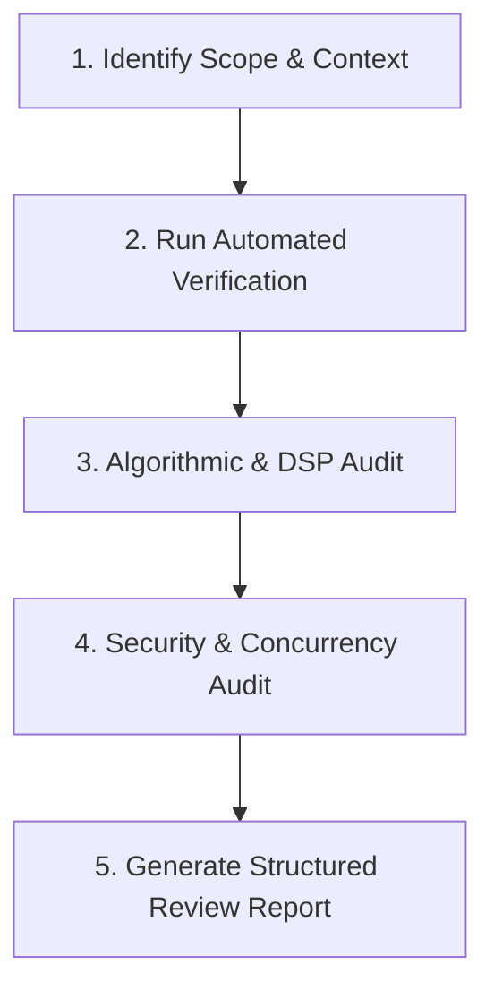

# MuTech Code Reviewer

This skill guides rigorous, multi-dimensional code reviews across the **MuTech** repository (Choir Pitch Tracker MVP & Systematic Literature Review assets). It ensures that all contributions uphold academic rigor, algorithmic precision, enterprise security, and software craftsmanship.

---

## Review Workflow

When requested to review code, a PR, a specific file, or recent modifications in the repository, follow this 5-stage review procedure:



### Stage 1: Identify Scope & Context
1. Identify target files:
   - **Backend Engine (`mvp/backend/`)**: FastAPI endpoints, audio pipeline, neural mf0 inference, contour linking, analytics, MIDI export.
   - **Frontend Studio (`mvp/frontend/`)**: Canvas 60fps rendering, Web Audio sync, SSE consumer, responsiveness.
   - **Tests (`mvp/backend/tests/`)**: Pytest suites, mocks, edge-case coverage.
   - **Documentation & Research (`mvp/docs/`, `slr/`, root `docs/`)**: API synchronization, checklist tracking, GitHub Pages integrity.
2. Read the latest relevant guidelines:
   - [DSP Review Reference](./references/dsp_review_checklist.md)
   - [Security & API Reference](./references/security_and_api_checklist.md)
   - Master Checklist: [IMPLEMENTATION_CHECKLIST.md](../../../mvp/docs/IMPLEMENTATION_CHECKLIST.md)

### Stage 2: Run Automated Verification
Before manual line-by-line review, execute the automated verification script:
```powershell
python .agents/skills/mutech-code-reviewer/scripts/run_reviewer_checks.py
```
Or execute the core test suite directly:
```powershell
python -m pytest mvp/backend/tests/test_suite.py -v
```
Ensure all 32 tests pass without regressions.

### Stage 3: Algorithmic & DSP Precision Audit
Verify domain-specific audio and MIR invariants:
1. **Pitch Units & Conversions**:
   - Ensure explicit distinction between linear frequency (Hz), logarithmic cents ($1200 \times \log_2(f / f_{\text{ref}})$), MIDI note numbers ($69 + 12 \log_2(f / 440)$), and pitch class sets ($0-11$).
   - Never compare raw frequencies with linear Euclidean distance; always evaluate pitch differences in musical cents.
2. **Sub-Bin Interpolation Precision**:
   - Verify parabolic peak interpolation guards against zero denominator ($\alpha - 2\beta + \gamma \neq 0$).
   - Confirm bounds clamping on peak offsets ($\Delta \in [-0.5, 0.5]$ bins).
3. **Voice Trajectory Continuity**:
   - Check that bipartite matching penalizes large cent jumps ($>80$ cents) and time gaps ($>25$ ms).
   - SATB Tessitura: Enforce non-crossing invariant between Soprano, Alto, Tenor, and Bass tracks at identical frame timestamps.
4. **Windowing & Stitching**:
   - Verify Hann window cross-fade summation ($w_1 + w_2 = 1.0$) across overlapping chunk boundaries to prevent audio/spectral discontinuities.
5. **Harmonic & Chord Detection**:
   - Confirm root note and inversion detection safely handles polyphony counts $N < 3$ without IndexError.

### Stage 4: Concurrency, API & Security Audit
1. **Non-Blocking Async Execution**:
   - Heavy DSP functions (`process_audio_pipeline`, `mf0_service.predict`, `extract_contours`, `export_midi`) **must** be executed in worker threads via `asyncio.to_thread(...)` or a thread pool, never directly in the main FastAPI async loop.
2. **Resource Exhaustion & DOS Protections**:
   - Validate upload size limits ($<50$ MB), audio length caps ($<10$ minutes), and file format whitelists (`.wav`, `.mp3`, `.ogg`, `.flac`, `.m4a`).
   - Validate that `job_manager` enforces TTL eviction so abandoned jobs do not cause memory leaks.
3. **Graceful Model Degradation**:
   - Check that missing model weights return HTTP `503 Service Unavailable` with actionable download instructions, rather than crashing or returning `500 Internal Server Error`.
4. **Path Traversal & Shell Injection**:
   - Ensure job IDs are validated UUIDs before accessing filesystem caches.
   - No untrusted user inputs passed to system shells.

---

## Review Report Output Format

Always present your code review using the following standardized schema:

### 1. Executive Summary
- Brief 2–3 sentence overview of the reviewed changes.
- Overall Recommendation: `APPROVED`, `APPROVED WITH NITS`, or `CHANGES REQUESTED`.

### 2. Automated Check Results
- Pytest Suite Status: `PASS (32/32)` or failure details.
- Syntax / Static Checks: Any discovered syntax, type, or lint anomalies.

### 3. Detailed Findings Table

| Severity | File & Line | Finding / Risk | Remediation |
| :--- | :--- | :--- | :--- |
| **Critical** | `path/to/file.py:L45` | Blocking sync I/O in async route | Wrap in `asyncio.to_thread` |
| **High** | `path/to/file.py:L112` | Division by zero risk when RMS is 0 | Add `eps = 1e-9` guard |
| **Medium** | `path/to/file.py:L88` | Missing SATB non-crossing check | Apply sorting by frequency |
| **Low / Nit** | `path/to/file.py:L20` | Undocumented function argument | Add docstring typing note |

*Severities:*
- **Critical**: Security exploit, service crash, thread starvation, data loss, or test failure.
- **High**: Algorithmic bug, severe performance degradation, memory leak, or broken API contract.
- **Medium**: Missing edge-case handling, minor precision loss, incomplete validation, or unhandled warning.
- **Low / Nit**: Style inconsistency, naming clarification, redundant comment, or minor documentation typo.

### 4. Positive Highlights & Commendations
Highlight well-architected implementations, elegant algorithms, or robust test cases.

### 5. Actionable Next Steps
Numbered list of exact changes required before merging or deploying.
