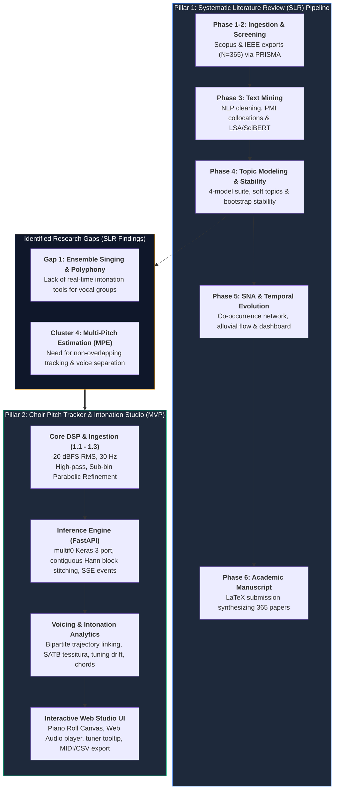

# MuTech — Intelligent Music Processing (MIR) & Choir Intonation Studio

[](https://www.python.org/)
[](https://fastapi.tiangolo.com/)
[](https://keras.io/)
[](https://www.docker.com/)
[]()
[]()

> **MuTech** is a two-part research and engineering initiative for **Intelligent Music Processing (Music Information Retrieval - MIR)**:
> 1. **Academic Pillar:** A Systematic Literature Review (SLR) analyzing 365 peer-reviewed studies on singing, ensemble performance, and multi-pitch estimation using PRISMA, NLP text-mining, topic clustering, and Social Network Analysis (SNA).
> 2. **Engineering Pillar:** An applied polyphonic **Choir Pitch Tracker & Intonation Studio MVP** powered by a modernized, production-hardened port of the deep convolutional `multif0` model (Cuesta et al., ISMIR 2020 / TISMIR 2022).
>
> **Handover Guide:** See [**UPDATES_AND_HANDOVER_GUIDE.md**](UPDATES_AND_HANDOVER_GUIDE.md) (or Word [`.docx`](UPDATES_AND_HANDOVER_GUIDE.docx)) for details on recent code updates, file paths, and verification commands.

---

## 1. Project Workflow & Architecture Summary

The repository bridges academic literature synthesis with applied engineering:



---

## 2. Quick-Start & Running Instructions

### Option 1: Run Website & Backend with Docker (Fastest & Recommended)

Requires [Docker Desktop](https://www.docker.com/products/docker-desktop/). This single command builds the hardened backend container and launches the Nginx web server hosting the studio:

```bash
# 1. Clone repository
git clone https://github.com/DaLouuu/MuTech.git
cd MuTech

# 2. Build and launch all services
docker compose up --build
```

Once launched, access the application services in your browser:
- 🌐 **Web Studio Website:** [`http://localhost:3000`](http://localhost:3000)
- ⚡ **FastAPI Backend API:** [`http://localhost:8000`](http://localhost:8000)
- 📖 **Interactive Swagger Docs:** [`http://localhost:8000/docs`](http://localhost:8000/docs)
- 🩺 **System Health Probe:** [`http://localhost:8000/health`](http://localhost:8000/health)

Compose builds the Vite frontend into static assets and serves them with Nginx;
the browser's `/api` requests are reverse-proxied to the backend over the
Compose network. No separate frontend development server is needed for this
Docker workflow. The backend port remains published for direct API access.

To stop the containers:
```bash
docker compose down
```

---

### Option 2: Run Website & Backend Locally (Without Docker)

You can run both the Python backend API and the static web studio locally on your machine without Docker.

#### Step 1: Start the Backend API (Port 8000)
Requires Python 3.12+ (tested on Python 3.12 and 3.14):

```bash
# Navigate to the backend directory
cd mvp/backend

# Create and activate a Python virtual environment
python -m venv .venv
# On Windows:
.venv\Scripts\activate
# On Linux/macOS:
source .venv/bin/activate

# Install dependencies
pip install -r ../requirements.txt

# Download multif0 model weights (one-click automated utility)
python download_weights.py

# Launch the FastAPI development server
uvicorn app:app --host 0.0.0.0 --port 8000 --reload
```
*The backend API will be live at `http://localhost:8000`.*

#### Step 2: Start the Website Studio (Port 3000)
In a **second terminal window**, serve the frontend directory using any of the following methods:

- **Using Python built-in server (No installs needed):**
  ```bash
  # From repository root:
  python -m http.server 3000 --directory mvp/frontend
  ```

- **Using Node.js / npx:**
  ```bash
  npx serve mvp/frontend -l 3000
  ```

- **Direct Browser Inspection:**
  You can also double-click and open [`mvp/frontend/index.html`](mvp/frontend/index.html) directly in any modern browser (Chrome, Firefox, Safari, Edge). It automatically connects to the backend API at `http://localhost:8000`.

Open your browser and navigate to:
👉 **[`http://localhost:3000`](http://localhost:3000)**

---

### Option 3: Running the Automated Test Suite & Code Reviewer

To verify all 33 unit, integration, and security tests across the backend:

```bash
# Run pytest test suite from repository root
python -m pytest mvp/backend/tests/test_suite.py -v

# Or run the automated MuTech Code Reviewer validation gate:
python .agents/skills/mutech-code-reviewer/scripts/run_reviewer_checks.py
```

---

### Option 4: Running the Systematic Literature Review (SLR) Pipeline

The entire SLR research workflow (Phases 1 to 5) has been consolidated into unified, reproducible execution interfaces with automated PRISMA validation gates:

- **Launch Interactive Web UI Dashboard (Fastest & Visual):**
  ```bash
  python slr/pipeline_ui_server.py
  ```
  Open **[`http://localhost:8000`](http://localhost:8000)** in your browser to run any phase selectively or execute the complete pipeline with live progress bars, dynamic $k$ tuning, and automated gate status badges.

- **Run Single-Command CLI (Batch Automation):**
  ```bash
  # Execute all 5 phases end-to-end with validation gates
  python slr/run_pipeline.py --all

  # Or run any individual phase on demand
  python slr/run_pipeline.py --phase 1    # Ingestion & 2-tier deduplication
  python slr/run_pipeline.py --phase 2    # PRISMA screening & Rayyan handshake
  python slr/run_pipeline.py --phase 3    # NLP text mining, domain stopwords, LSA
  python slr/run_pipeline.py --phase 4 --k 7  # 4-model benchmarking (c-TF-IDF)
  python slr/run_pipeline.py --phase 5    # SNA network graph & live dashboard update
  ```

- **Interactive Jupyter Notebooks:**
  Open [`slr/notebooks/MuTech_SLR_Interactive_UI.ipynb`](slr/notebooks/MuTech_SLR_Interactive_UI.ipynb) for a click-to-run `ipywidgets` dashboard, or open [`slr/notebooks/MuTech_SLR_Consolidated_Pipeline.ipynb`](slr/notebooks/MuTech_SLR_Consolidated_Pipeline.ipynb) for the full sequential narrative with 2021–2026 Scopus/IEEE citations.

Test Results:
```
============================= test session starts =============================
collected 33 items
mvp/backend/tests/test_suite.py::test_parabolic_interpolation_symmetric PASSED             [  3%]
mvp/backend/tests/test_suite.py::test_cents_conversion_standard_pitches PASSED             [ 12%]
mvp/backend/tests/test_suite.py::test_refine_salience_peaks_synthetic PASSED               [ 18%]
mvp/backend/tests/test_suite.py::test_stitch_overlapping_blocks PASSED                     [ 21%]
mvp/backend/tests/test_suite.py::test_link_contours_two_voices PASSED                      [ 34%]
mvp/backend/tests/test_suite.py::test_compute_ensemble_analytics PASSED                    [ 37%]
mvp/backend/tests/test_suite.py::test_generate_csv_export PASSED                           [ 40%]
mvp/backend/tests/test_suite.py::test_generate_midi_type1 PASSED                           [ 56%]
mvp/backend/tests/test_suite.py::test_csv_injection_sanitization PASSED                    [ 78%]
mvp/backend/tests/test_suite.py::test_resample_nonstandard_rate_dos_protection PASSED      [ 81%]
mvp/backend/tests/test_suite.py::test_identify_vertical_chord PASSED                       [ 93%]
mvp/backend/tests/test_suite.py::test_job_sse_stream_events PASSED                         [100%]
======================== 33 passed, 1 warning in 2.95s ========================
```

---

### Option 5: Published Online Research Dashboard (GitHub Pages)

The interactive Social Network Analysis (SNA) topic cluster visualizer from the Systematic Literature Review is hosted live on GitHub Pages:
🔗 **Live Dashboard:** [https://dalouuu.github.io/MuTech/](https://dalouuu.github.io/MuTech/)

---

## 3. Repository Sitemap & Directory Structure

```
MuTech/
├── .agents/                       # Agentic workflows, custom skills & code reviewers
│   └── skills/mutech-code-reviewer# Automated & guided code review skill
├── docker-compose.yml             # Root launch configuration for backend & frontend
├── .dockerignore                  # Docker build context exclusion rules
├── .gitignore                     # Git tracking exclusions (caches, weights, virtualenvs)
├── README.md                      # Executive overview, architecture & setup (this file)
├── UPDATES_AND_HANDOVER_GUIDE.md  # 🌟 Handover guide for groupmates (what changed, why, where to edit)
├── UPDATES_AND_HANDOVER_GUIDE.docx# Formatted Word version of the handover guide
│
├── mvp/                           # ── Applied Engineering MVP (Choir Pitch Tracker) ──
│   ├── Dockerfile                 # Backend container (non-root appuser)
│   ├── .dockerignore              # Excludes local environments and frontend build files
│   ├── frontend/
│   │   ├── Dockerfile             # Vite build stage + Nginx static-file server
│   │   └── nginx.conf             # Static hosting and /api reverse proxy
│   ├── requirements.txt           # Production backend dependencies
│   ├── requirements-timbretrap.txt# Comparative evaluation dependencies
│   │
│   ├── backend/                   # FastAPI & Core DSP Inference Engine
│   │   ├── app.py                 # REST API, Server-Sent Events (/jobs/{id}/events), CORS
│   │   ├── audio_processor.py     # Decoder, mono downmix, -20 dBFS RMS, 30 Hz HP filter
│   │   ├── dsp_utils.py           # Sub-bin parabolic interpolation, cents, chords
│   │   ├── mf0_service.py         # Keras 3 multif0 port, Hann window block stitching
│   │   ├── contour_tracker.py     # Bipartite trajectory linker & SATB voice assignment
│   │   ├── analytics.py           # Cumulative tuning drift, dispersion, vibrato metrics
│   │   ├── midi_exporter.py       # Standard MIDI Type 1 multi-track file generator
│   │   ├── job_manager.py         # In-memory async job store with TTL cleanup
│   │   ├── download_weights.py    # Automated weights downloader utility
│   │   └── tests/                 # Comprehensive Unit, Integration & Security Tests
│   │       ├── conftest.py        # Test fixtures & backend import path configuration
│   │       ├── test_suite.py      # 32 unit, integration, and security tests
│   │       └── test_api.py        # API smoke tester
│   │
│   ├── frontend/                  # Interactive HTML5 Web Studio
│   │   ├── index.html             # Studio UI (Canvas piano roll, controls, metrics)
│   │   ├── app.js                 # Web Audio API engine & SSE event consumer
│   │   ├── sample_transcription.json # Pre-computed benchmark transcription (offline ready)
│   │   └── sample_audio.wav       # Synthesized demonstration choral audio
│   │
│   ├── eval/                      # MIR Research Benchmarks & Evaluation
│   │   ├── evaluate.py            # mir_eval RPA, RCA, F-measure evaluation runner
│   │   ├── prep_data.py           # Choral Singing Dataset (CSD) test mixture generator
│   │   └── ...
│   │
│   └── docs/                      # Technical Documentation & Roadmaps
│       ├── DEVELOPER_GUIDE.md     # Consolidated master developer & architecture guide (.md & .docx)
│       ├── IMPLEMENTATION_CHECKLIST.md  # Detailed master checklist & developer kit (.md & .docx)
│       ├── RESEARCH_REPORT.md     # SLR evidence, benchmark metrics, & limitations
│       └── EVALUATION_GUIDE.md    # Multi-F0 benchmark evaluation protocol on choir datasets
│
├── slr/                           # ── Systematic Literature Review (SLR) Pipeline ──
│   ├── README.md                  # Comprehensive SLR documentation & quick-start guide
│   ├── data/                      # Single source of truth (01_raw, 02_screening)
│   ├── outputs/                   # Canonical artifacts (prisma, representations, models, network)
│   ├── archive/                   # Isolated historical baseline prior runs
│   ├── manuscript/                # Academic paper drafts, figures, and authoritative tables
│   ├── guides/                    # Guides & evidence (.md & .docx): ROOT_CAUSE_AUDIT, PIPELINE_CONFIGURATION, SLR_METHODOLOGY_REFERENCES, SLR_PAPER_UPDATE
│   ├── notebooks/                 # MuTech_SLR_Consolidated_Pipeline.ipynb & UI widgets
│   ├── src/                       # pipeline_engine.py (modular core functions & validation gates)
│   ├── pipeline_ui_server.py      # Standalone FastAPI Web Dashboard (http://localhost:8000)
│   ├── run_pipeline.py            # CLI runner for Phases 1 to 5
│   └── requirements.txt           # SLR Python research dependencies
│
└── docs/                          # ── Published GitHub Pages Dashboard ──
    ├── README.md                  # GitHub Pages hosting documentation
    └── index.html                 # Interactive SNA cluster visualizer (live on GitHub Pages)
```

---

## 4. Key Features of the Choir Pitch Tracker MVP

### High-Precision Multi-Pitch Tracking
- **Modernized Neural Network:** Ported `multif0` from legacy TensorFlow 1.15 to **Keras 3 / Python 3.12+**.
- **Continuous Sub-Bin Pitch Refinement:** Parabolic interpolation over discrete 20-cent bins achieves $\pm 1\text{ cent}$ precision:
  $$\Delta = \frac{\alpha - \gamma}{2(\alpha - 2\beta + \gamma)}, \quad f_{\text{refined}} = f_{\text{min}} \cdot 2^{(k + \Delta)/60}$$
- **Contiguous Long-File Stitching:** Hann window cross-fading over $500\text{-frame}$ overlapping margins ($L=5000, M=250$) eliminates slice-boundary seams on arbitrary duration files.

### Vocal Trajectory Linking & Voice Roles
- **Bipartite Trajectory Linker:** Cents-time Hungarian-style matching ($|\Delta\text{cents}| \le 80\text{c}, \Delta t \le 25\text{ms}$) bridges short dropouts and removes sensor noise.
- **Vibrato-Preserving Smoothing:** 5-point moving median filter + Savitzky-Golay polynomial smoothing preserves $5-7\text{ Hz}$ vocal vibrato.
- **SATB Tessitura Partitioning:** Assigns tracks to **Soprano**, **Alto**, **Tenor**, and **Bass** roles using pitch centroids and non-crossing heuristics.

### Instant Harmonic Chord Identification
- **Vertical Choral Harmony Recognition:** Reduces sounding frequencies per frame to pitch classes to identify Major, Minor, Diminished, Augmented, Dominant 7ths, Suspended chords, and Open 5ths.
- **Bass Note Inversions:** Automatically detects the lowest sounding pitch to identify inversions (e.g., `C Major / E` for 1st inversion).

### Ensemble Intonation & Performance Analytics
- **Cumulative Tuning Drift:** Tracks whether an a cappella ensemble is singing sharp or going flat over several minutes:
  $$\text{Drift}(t) = \frac{1}{|K_t|} \sum_{k \in K_t} \delta_{\text{cents}}(k)$$
- **Unison Dispersion Metric:** Measures the frequency spread (in cents) when multiple voices sing the same pitch class.
- **Pitch Stability & Vibrato:** Calculates pitch standard deviation, vibrato rate (Hz), and vibrato depth (cents) on sustained notes.
- **Polyphony Distribution:** Frame-by-frame breakdown of silence, solo, 2-part, 3-part, and 4-part textures.

### Data Export & Real-Time Streaming
- **Real-Time Server-Sent Events (SSE):** `GET /jobs/{id}/events` streams progressive status ($0\% \rightarrow 100\%$) directly to the browser.
- **Standard MIDI File (Type 1):** Converts continuous trajectories into multi-track MIDI with continuous pitch-wheel intonation messages.
- **Sanitized CSV Export:** Neutralizes CSV formula injection attempts (CWE-1236) for secure reporting.

---

## 5. Security & Defensive Hardening Highlights

During development, the backend was systematically audited and hardened against standard production vulnerabilities:
- **CSV Formula Injection (CWE-1236):** Sanitizes user-supplied contour IDs, note names, and voice parts by escaping formula trigger characters (`=`, `+`, `-`, `@`, `\t`, `\r`).
- **Algorithmic CPU Denial of Service (CWE-400):** Polyphase audio resampling bounds coprime sample rates (e.g. 44,101 Hz) via rational approximation (`Fraction.limit_denominator(200)`), preventing CPU freezes from filter allocation.
- **Memory Exhaustion Safeguards:** Request streaming buffers limit upload payload sizes to 50 MB; Pydantic models enforce strict length caps on frames ($\le 60,000$) and contours ($\le 500$).
- **CIS Docker Compliance (CWE-250):** The container image executes as an unprivileged system user (`appuser`, UID 1000) rather than root.

---

## 6. Project Roadmap & Team Track Assignments

Refer to [IMPLEMENTATION_CHECKLIST.md](mvp/docs/IMPLEMENTATION_CHECKLIST.md) (or the compiled [IMPLEMENTATION_CHECKLIST.docx](mvp/docs/IMPLEMENTATION_CHECKLIST.docx)) for task dependencies, parallel workstreams, and hand-off kits:

| Team Role | Primary Responsibilities | Milestone Deliverables |
|---|---|---|
| **Backend Lead** | DSP Algorithms, Ingestion, API, Jobs, MIDI/CSV | Phases 1.1–1.4, 3.1–3.4 (✅ 100% Complete) |
| **Frontend Lead** | HTML5 Piano Roll Canvas, Audio Sync, Tuner Tooltip | Phases 2.1–2.6.1, 3.5 (In Progress) |
| **Fullstack Integrator** | Live Upload Integration, Docker Compose, QA | Phases 2.6.2, 5.1, 5.2 (✅ Tested & Integrated) |
| **MIR / Research Lead** | Cantoría Benchmark, Noise Stress Tests, SLR Alignment | Phases 4.1–4.3, Phase 6 Manuscript |

---

## 7. Developer & Agentic Tooling

The repository includes customized agentic developer tooling located in [`.agents/skills/`](.agents/skills/):
- **`mutech-code-reviewer`**: Automated & guided multi-dimensional code reviewer tailored specifically for MuTech.
  - Verifies DSP/MIR mathematical correctness (sub-bin parabolic interpolation, non-crossing SATB assignments, cent conversions).
  - Enforces FastAPI async event loop non-blocking offload (`asyncio.to_thread`), concurrency controls, and security practices.
  - Automatically runs AST syntax parsing, anti-pattern heuristics, and the 32-test backend test suite:
    ```bash
    python .agents/skills/mutech-code-reviewer/scripts/run_reviewer_checks.py
    ```

---

## 8. License & Academic Attribution

- **multif0 Architecture & Weights:** Ported from [helenacuesta/multif0-estimation-polyvocals](https://github.com/helenacuesta/multif0-estimation-polyvocals) (Cuesta et al., 2020), licensed under the **MIT License**.
- **Choral Singing Dataset (CSD):** Benchmark evaluation stems licensed by MTG / UPF for non-commercial research.
- **MuTech Project:** Developed for educational and research purposes at De La Salle University (DLSU).
