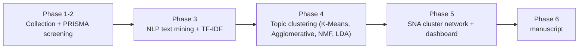

# MuTech — Systematic Literature Review on Intelligent Music Processing (MIR)

A team SLR pipeline: collect candidate papers, screen them, mine and vectorize the text,
and cluster them into thematic topics.

## Pipeline

| Folder | Stage | Status |
| --- | --- | --- |
| [`phase1_2/`](phase1_2) | Collection (Scopus/IEEE) + PRISMA screening (Rayyan) | ✅ Done — 365 papers included |
| [`phase3/`](phase3) | NLP cleaning, tokenization, TF-IDF vectorization | ✅ Done — real run on 365 papers |
| [`phase4/`](phase4) | Topic clustering — one model per owner (K-Means, Agglomerative, NMF, LDA) | ✅ Quick pipeline + detailed leakage-safe validation notebook both done; **K-Means selected as final model** |
| [`phase5/`](phase5) | Cluster-relationship network (NetworkX + Gephi) + dashboard refresh | ✅ Done — modularity 0.53, dashboard rebuilt on final 365-paper corpus |
| [`docs/`](docs) | SNA dashboard (GitHub Pages) | Published, rebuilt by Phase 5 on the final included corpus |
| Phase 6 | Manuscript | Not started |
| [`mvp/`](mvp) | MVP base: ported multif0 choir pitch tracker, API, evaluation, docs | In progress (see [mvp/README.md](mvp/README.md)) |

Each phase folder has its own README with the detailed pipeline diagram, inputs/outputs,
and how to run it — start there for specifics.
