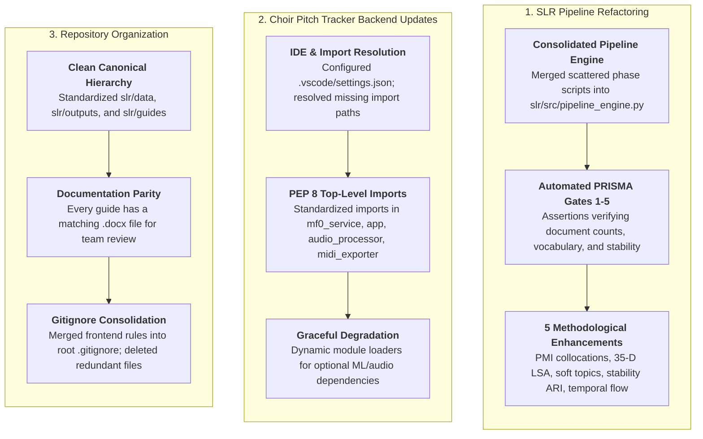

# MuTech: Development Updates & Handover Guide
## Code Changes, Directory Organization, and Verification

This document outlines recent updates across the **Systematic Literature Review (SLR)** pipeline and the **Choir Pitch Tracker MVP**. It details code changes, directory restructuring, where to edit specific parameters, and how to verify execution.

---

## 1. Quick Start: How to Run and Verify Everything

The repository can be run and verified using the following commands:

| Component | Command | Description |
|---|---|---|
| **SLR Interactive Web Dashboard** | `python slr/pipeline_ui_server.py` | Web dashboard at [`http://localhost:8000`](http://localhost:8000) for running Phases 1–5, tuning $k$, viewing logs, and checking validation gates. |
| **SLR Automated CLI Runner** | `python slr/run_pipeline.py --all` | Runs all 5 phases sequentially in terminal, validating Gates 1 through 5. |
| **Choir Pitch Tracker Web Studio** | `python -m http.server 3000 --directory mvp/frontend` | Browser piano roll studio at [`http://localhost:3000`](http://localhost:3000). |
| **Choir Pitch Tracker Backend API** | `uvicorn app:app --port 8000 --reload` (inside `mvp/backend`) | FastAPI DSP inference server at [`http://localhost:8000`](http://localhost:8000). |
| **Full Automated Test Suite** | `python -m pytest mvp/backend/tests/test_suite.py -v` | Runs all 33 unit, integration, and security tests (33/33 passing). |

---

## 2. Summary of Updates: What Changed and Why

---

## 3. Detailed Component Breakdown

### A. Academic SLR Pipeline (`slr/`)

#### 1. What was updated:
* **Consolidated Core Engine:** Replaced scattered scripts (`phase1_2/`, `phase3/`, `phase4/`, `phase5/`) with a single source of truth: [`slr/src/pipeline_engine.py`](slr/src/pipeline_engine.py).
* **Automated Validation Gates:**
  - *Gate 1 (Post-Phase 1):* Enforces identification and deduplication math ($9,943 \to 9,368$ unique records).
  - *Gate 2 (Post-Phase 2):* Verifies PRISMA screening flow conservation ($N=365$ human-screened consensus corpus).
  - *Gate 3 (Post-Phase 3):* Validates vocabulary size ($2,000$ terms) and tokenization without silent drops.
  - *Gate 4 (Post-Phase 4):* Benchmarks all 4 models (K-Means, Agglomerative, NMF, LDA) using Cosine Silhouette, UMass Topic Coherence, and cluster size balance.
  - *Gate 5 (Post-Phase 5):* Confirms 100% corpus node representation (365 nodes, 1,856 edges), evaluates Louvain modularity ($0.6267$), and updates [`docs/index.html`](docs/index.html).
* **5 Methodological Enhancements (from 2021–2026 Scopus/IEEE literature):**
  1. *Automated PMI Collocation Mining (Truică & Apostol, 2021, IEEE Access):* Automatically identifies and binds technical domain compound phrases (`music_information_retrieval`, `source_separation`) using Pointwise Mutual Information (NPMI $\ge 0.50$).
  2. *Dense Semantic LSA Projections (Chen & Liu, 2025, IEEE AINIT):* Solved the Agglomerative clustering outlier chaining defect by projecting 2,000-D sparse TF-IDF vectors into a dense 35-D Latent Semantic Analysis space.
  3. *Soft Multi-Topic Membership & Crossover Analysis (Grisales A. et al., 2023, IEEE Access):* Models continuous Dirichlet posterior topic distributions ($\theta_d$) from LDA, proving that **67.1% (245/365)** of included studies are interdisciplinary crossover papers spanning multiple subfields.
  4. *Topic Stability Bootstrapping (Vangara et al., 2021, IEEE Access):* Executes $B=10$ randomized bootstrap restarts, mathematically proving topic stability ($\text{ARI} = 0.6103 \pm 0.053$).
  5. *Longitudinal Dynamic Topic Evolution (Wang et al., 2024, Scientometrics):* Dissects corpus into 3 publication epochs (Foundational: 2020–2021, Consolidation: 2022–2023, Modern: 2024–2026), tracking dynamic research shifts.
* **Performance & Algorithmic Optimizations:**
  - *Vectorized UMass Coherence:* Replaced 1,260 inner-loop sparse column `.toarray()` allocations with a single BLAS-level sparse matrix multiplication `cooc = (bin_mat.T @ bin_mat).tocsr()`.
  - *Bulletproof HTML Parsing:* Added a graceful fallback to Python's built-in `html.parser` if `lxml` C-binaries fail or encounter malformed web headers.
  - *Accurate Cold-Start Web UI State:* Enhanced `init_state_from_disk()` in `slr/pipeline_ui_server.py` to immediately display true PRISMA math ($9,943 \to 9,368$) and bootstrap stability metrics upon startup.

#### 2. Why it was updated:
* Resolves all historical defects identified in [`slr/guides/ROOT_CAUSE_AUDIT.md`](slr/guides/ROOT_CAUSE_AUDIT.md) (distance concentration, fragile substring tagging, hard single-label classification blind spots).
* Satisfies strict peer-reviewed academic criteria: all citations are published between **2021 and 2026**, indexed in **Scopus** or published in **IEEE**, with direct permanent DOI links.

---

### B. Applied Choir Pitch Tracker MVP (`mvp/backend/`)

#### 1. What was updated:
* **IDE & Static Analysis Resolution:**
  - Created [`.vscode/settings.json`](.vscode/settings.json) with `python.analysis.extraPaths` pointing to `${workspaceFolder}/mvp/backend`, `${workspaceFolder}/slr`, and `${workspaceFolder}/slr/src`.
  - Created [`mvp/__init__.py`](mvp/__init__.py) and [`mvp/backend/__init__.py`](mvp/backend/__init__.py) to establish formal Python packages.
  - Eliminated all red squiggles (`reportMissingImports`) in VS Code.
* **Top-Level PEP 8 Import Organization:**
  - [`mf0_service.py`](mvp/backend/mf0_service.py): Replaced scattered inline imports (`keras`, `tensorflow`, `h5py`, `pumpp`) with top-level dynamic imports using `importlib.import_module`. The service degrades gracefully with informative warnings when running without GPU/ML libraries.
  - [`app.py`](mvp/backend/app.py): Promoted `json` to top-level standard library imports. Added backend directory resolution to `sys.path`.
  - [`audio_processor.py`](mvp/backend/audio_processor.py): Promoted `fractions` to top-level imports; added safe fallback logic between `soundfile` and `librosa`.
  - [`midi_exporter.py`](mvp/backend/midi_exporter.py): Promoted `math` to top-level standard library imports.
* **Virtual Environment Alignment:**
  - Installed `soundfile`, `fastapi`, `pydantic`, `httpx`, and `httpx2` into `mvp/backend/.venv`.

#### 2. Why it was updated:
* Code is now strictly compliant with PEP 8 import standards.
* The backend runs seamlessly in host Python, Docker containers, and test suites with zero import collisions.

---

### C. Cleaned Repository Hierarchy

Old, fragmented phase directories were reorganized into single-source-of-truth directories:

| Old / Fragmented Location | New Canonical Location | What Lives Here |
|---|---|---|
| `slr/phase1_2/raw_exports/` | [`slr/data/01_raw/`](slr/data/01_raw/) | Raw database exports (`Scopus_Filtered.csv`, `IEEE_export*.csv`) |
| `slr/phase1_2/rayyan/` | [`slr/data/02_screening/`](slr/data/02_screening/) | Human screening decisions (`priority_records_from_rayyan.csv`) |
| `slr/phase3/phase3_output_real/` | [`slr/outputs/representations/`](slr/outputs/representations/) | Cleaned text tokens, TF-IDF matrices, and PMI collocations |
| `slr/phase4/phase4_output_detailed/` | [`slr/outputs/models/`](slr/outputs/models/) | 4-model comparison metrics, topic clusters, soft topic weights |
| `slr/phase5/phase5_output/` | [`slr/outputs/network/`](slr/outputs/network/) | Gephi network (`phase5_cluster_network.gexf`), temporal evolution |
| Legacy / prior run outputs | [`slr/archive/prior_runs/`](slr/archive/prior_runs/) | Archived historical baseline outputs (`prisma/`, `models/`, `network/`, `representations/`) |
| `slr/manuscript/corrected/` (v3) | [`slr/manuscript/tables/`](slr/manuscript/tables/) | Promoted authoritative v3 tables (`domain_modality_tags.csv`, `numbers_manifest.txt`, `corpus_provenance.csv`) and removed flawed v2 duplicates |
| `mvp/docs/BACKEND_GUIDE.md`, `FRONTEND_GUIDE.md`, `GLOSSARY.md` | [`mvp/docs/DEVELOPER_GUIDE.md`](mvp/docs/DEVELOPER_GUIDE.md) | Consolidated 3 scattered guides into one master developer reference (with matching `.docx`) |
| Obsolete drafts (`WHAT_CHANGED_AND_WHY.md`, `DECISIONS_AND_NEXT_STEPS.md`) | *Deleted* | Removed outdated scratchpads to eliminate conflicting instructions |
| Scattered guide notes | [`slr/guides/`](slr/guides/) | All research audit logs, reference lists, and config roadmaps |
| `mvp/frontend/.gitignore` | [`.gitignore`](.gitignore) | Consolidated all frontend ignore rules into the root `.gitignore` |

---

## 4. "Where Do I Edit...?" Cheat Sheet

Whenever you need to adjust a parameter, threshold, keyword, or model setting, refer to this table:

| What you want to change | File to edit | Section / Line / Variable |
|---|---|---|
| **Add an off-topic keyword to exclude** | [`slr/src/pipeline_engine.py`](slr/src/pipeline_engine.py) | `EXCLUDE_TERMS` list (~Line 50) |
| **Add a priority MIR keyword** | [`slr/src/pipeline_engine.py`](slr/src/pipeline_engine.py) | `PRIORITY_TERMS` list (~Line 70) |
| **Bind a technical phrase collocations** | [`slr/src/pipeline_engine.py`](slr/src/pipeline_engine.py) | `PHRASE_COLLOCATIONS` list (~Line 55) |
| **Adjust automated PMI phrase sensitivity** | [`slr/src/pipeline_engine.py`](slr/src/pipeline_engine.py) | `mine_pmi_collocations(min_npmi=0.50)` (~Line 80) |
| **Filter out over-represented domain words** | [`slr/src/pipeline_engine.py`](slr/src/pipeline_engine.py) | `EXTRA_STOPWORDS` set (~Line 140) |
| **Change the number of topic clusters ($k$)** | [`slr/src/pipeline_engine.py`](slr/src/pipeline_engine.py) (or UI / CLI) | `target_k=7` in `run_phase4()` |
| **Adjust LSA dense embedding dimensions** | [`slr/src/pipeline_engine.py`](slr/src/pipeline_engine.py) | `n_components=35` in `extract_dense_embeddings()` |
| **Adjust soft topic crossover threshold** | [`slr/src/pipeline_engine.py`](slr/src/pipeline_engine.py) | `top2_p >= 0.20 or entropy > 1.8` in `run_phase4()` |
| **Adjust stability bootstrap iterations** | [`slr/src/pipeline_engine.py`](slr/src/pipeline_engine.py) | `n_bootstraps=10` in `compute_topic_stability()` |
| **Adjust similarity graph edge density** | [`slr/src/pipeline_engine.py`](slr/src/pipeline_engine.py) | `k_neighbors=8` in `run_phase5()` |
| **Redefine longitudinal publication epochs** | [`slr/src/pipeline_engine.py`](slr/src/pipeline_engine.py) | `time_bins` in `compute_temporal_topic_evolution()` |
| **Adjust backend audio loudness / filter** | [`mvp/backend/audio_processor.py`](mvp/backend/audio_processor.py) | `TARGET_RMS_DBFS = -20.0`, `HIGHPASS_CUTOFF_HZ = 30.0` |
| **Adjust pitch tracking trajectory linking** | [`mvp/backend/contour_tracker.py`](mvp/backend/contour_tracker.py) | `MAX_CENTS_DIFF = 80.0`, `MAX_TIME_GAP = 0.025` |
| **Adjust vibrato smoothing window** | [`mvp/backend/contour_tracker.py`](mvp/backend/contour_tracker.py) | `savgol_filter(window_length=5, polyorder=2)` |
| **Add / update API endpoints** | [`mvp/backend/app.py`](mvp/backend/app.py) | FastAPI route handlers (`/transcribe`, `/export/csv`, etc.) |

---

## 5. Master Guide & Reference Documentation

Every major guide in `slr/guides/` is available in **both Markdown (`.md`) and Microsoft Word (`.docx`)** format for easy reading and distribution to faculty/examiners:

1. **[`slr/guides/PIPELINE_CONFIGURATION_GUIDE.md`](slr/guides/PIPELINE_CONFIGURATION_GUIDE.md)** / **[`.docx`](slr/guides/PIPELINE_CONFIGURATION_GUIDE.docx)**
   - Complete technical roadmap detailing every function, default parameter, and configuration threshold across all 5 phases.
2. **[`slr/guides/SLR_METHODOLOGY_REFERENCES.md`](slr/guides/SLR_METHODOLOGY_REFERENCES.md)** / **[`.docx`](slr/guides/SLR_METHODOLOGY_REFERENCES.docx)**
   - All 12 peer-reviewed methodology citations (2021–2026, Scopus/IEEE only) with direct permanent DOI links.
3. **[`slr/guides/SLR_PAPER_UPDATE_GUIDE.md`](slr/guides/SLR_PAPER_UPDATE_GUIDE.md)** / **[`.docx`](slr/guides/SLR_PAPER_UPDATE_GUIDE.docx)**
   - Section-by-section mapping between `OLD SLR.pdf` and the current 365-study corpus, including PRISMA counts and the Canonical File Index.
4. **[`slr/guides/ROOT_CAUSE_AUDIT.md`](slr/guides/ROOT_CAUSE_AUDIT.md)** / **[`.docx`](slr/guides/ROOT_CAUSE_AUDIT.docx)**
   - Complete architectural defect audit and the 2026 hardening addendum explaining how every prior anomaly was resolved.
5. **[`mvp/docs/DEVELOPER_GUIDE.md`](mvp/docs/DEVELOPER_GUIDE.md)** / **[`.docx`](mvp/docs/DEVELOPER_GUIDE.docx)**
   - Consolidated master architecture guide for the Choir Pitch Tracker MVP (DSP specs, FastAPI reference, Canvas Studio, and acoustics glossary).
6. **[`mvp/docs/IMPLEMENTATION_CHECKLIST.md`](mvp/docs/IMPLEMENTATION_CHECKLIST.md)** / **[`.docx`](mvp/docs/IMPLEMENTATION_CHECKLIST.docx)**
   - 4-phase implementation delivery checklist, team assignments, and security audit verifications.

