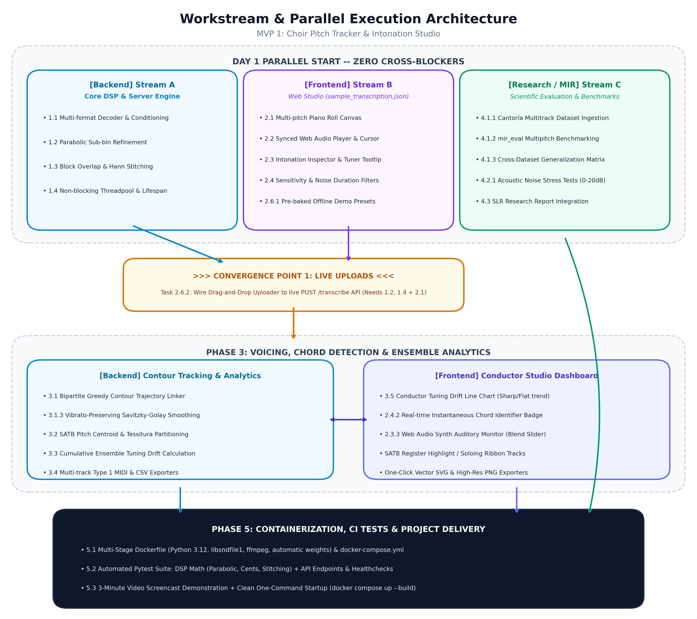
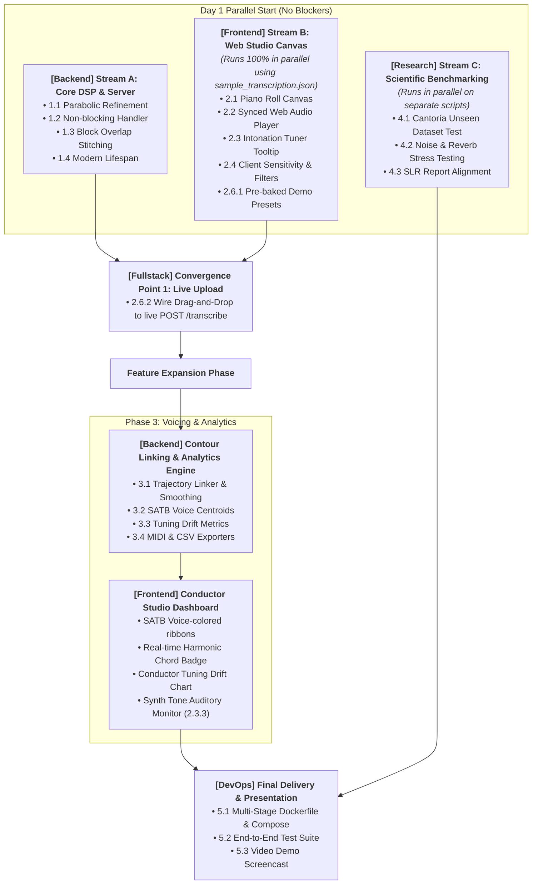

# MVP 1 Implementation & Expansion Checklist: Choir Pitch Tracker & Intonation Studio

> **Target:** `multif0` (Cuesta, McFee & Gómez, ISMIR 2020 / Cuesta & Gómez, TISMIR 2022)  
> **Application:** Polyphonic Vocal & Choir Pitch Tracking, Repertoire Visualization, and Ensemble Intonation Analytics  
> **Status:** Active Engineering Roadmap  
> **Related Documentation:** [Backend Guide](BACKEND_GUIDE.md) | [Frontend Guide](FRONTEND_GUIDE.md) | [Research Report](RESEARCH_REPORT.md) | [Decisions & Next Steps](DECISIONS_AND_NEXT_STEPS.md) | [Glossary](GLOSSARY.md)

---

## Executive Summary & Progress Dashboard

### Workstream & Parallel Execution Flowchart





---

### Workstream Dependency & Parallelization Matrix

| Task ID | Task Title | Track / Owner | Parallelization Status | Exact Dependencies / Blockers | Unblocks |
|---|---|---|---|---|---|
| **1.1** | Audio Ingestion & Conditioning | **Backend** | ⚡ **Parallel** | None (can start immediately) | 1.2, 1.3 |
| **1.2** | Parabolic Sub-Bin Interpolation | **Backend** | ⚡ **Parallel** | None (can start immediately) | 1.4, 2.6.2, 3.1 |
| **1.3** | Block Overlap & Hann Cross-Fading | **Backend** | ⚡ **Parallel** | Requires 1.1 | 1.4, 2.6.2 |
| **1.4** | Non-blocking Threadpool & Lifespan | **Backend** | ⏳ **Sequential** | Requires 1.1, 1.2 | 2.6.2, 5.1 |
| **2.1** | High-Performance Piano Roll Canvas | **Frontend** | ⚡ **Parallel** | None (uses `sample_transcription.json`) | 2.2, 2.3 |
| **2.2** | Synced Web Audio Player & Playhead | **Frontend** | ⏳ **Sequential** | Requires 2.1 | 2.3, 2.4 |
| **2.3** | Intonation Tooltip & Tuner Dial | **Frontend** | ⏳ **Sequential** | Requires 2.1 | 2.4 |
| **2.4** | Client Sensitivity & Duration Filters | **Frontend** | ⚡ **Parallel** | Requires 2.1 | 2.6.1 |
| **2.5** | Real-Time Synth Monitor (Web Audio) | **Frontend** | ⚡ **Parallel** | Requires 2.2 | 5.3 |
| **2.6.1**| Pre-loaded Academic Demo Presets | **Frontend** | ⚡ **Parallel** | Requires 2.1, 2.2 (Offline JSON) | 5.3 |
| **2.6.2**| Live File Upload & Backend Hookup | **Fullstack** | 🔴 **CONVERGENCE** | **BLOCKED BY:** Backend 1.2, 1.4 AND Frontend 2.1 | Phase 3, 5.1 |
| **3.1** | Frame-to-Frame Trajectory Linking | **Backend** | ⏳ **Sequential** | Requires 1.2 (Refined Hz) | 3.2, 3.3, 3.4 |
| **3.2** | SATB Voice Centroid Partitioning | **Backend** | ⏳ **Sequential** | Requires 3.1 | Frontend Voice Colors |
| **3.3** | Ensemble Tuning Drift & Metrics | **Backend** | ⏳ **Sequential** | Requires 3.1 | Frontend Analytics |
| **3.4** | MIDI & CSV Exporters | **Backend** | ⚡ **Parallel** | Requires 3.1 | 5.3 |
| **3.5** | Conductor Dashboard & Chord Badge | **Frontend** | ⏳ **Sequential** | Requires Backend 3.2, 3.3 contract | 5.3 |
| **4.1** | Cantoría Unseen Dataset Benchmark | **Research** | ⚡ **Parallel** | None (can start immediately in `eval/`) | 4.3 |
| **4.2** | Noise & Reverb Stress Testing | **Research** | ⚡ **Parallel** | None (can start immediately in `eval/`) | 4.3 |
| **4.3** | SLR Research Report Alignment | **Research** | ⏳ **Sequential** | Requires 4.1, 4.2 | 5.3 |
| **5.1** | Multi-Stage Dockerfile & Compose | **DevOps** | ⏳ **Sequential** | Requires 1.4 (Backend) and Frontend build | 5.2 |
| **5.2** | Automated Test Suite (`pytest`) | **Fullstack** | ⏳ **Sequential** | Requires 1.2, 1.4, 3.1 | 5.3 |
| **5.3** | Video Walkthrough & Presentation | **All** | ⏳ **Final Step** | Requires 2.6.2, 3.5, 4.3 | Project Delivery |

---

## Developer Quick-Start & Data Contract (Day 1 Hand-Off Kit)

> **To start working immediately without blockers:**
> - **Frontend Developer:** You **do not** need Python or the backend running. A complete mock response is checked into [`../frontend/sample_transcription.json`](../frontend/sample_transcription.json). Import or fetch it directly to build the entire UI!
> - **Backend Developer:** See the Pydantic schema and exact function signatures below. You can test your changes independently using `pytest` or `python test_api.py`.
> - **Research Lead:** You can immediately clone the Cantoría dataset and run evaluations using `eval/evaluate.py`.

### 1. The Unified API Data Contract (TypeScript & Pydantic)

Both backend and frontend must adhere strictly to this schema:

```typescript
// Shared Data Contract for /transcribe endpoint
export interface TranscribeResponse {
  sample_rate: number;         // 22050 Hz
  hop_s: number;               // 0.01161 s (~11.6 ms per frame)
  n_frames: number;            // Total frames analyzed
  duration_s: number;          // Total audio length in seconds
  threshold: number;           // Salience threshold used (e.g., 0.5)
  process_s: number;           // Inference duration on server in seconds
  
  // Per-frame time series (ordered chronologically)
  frames: FrameData[];
  
  // Linked vocal contours (populated when link_contours=true)
  contours?: ContourTrajectory[];
  
  // High-level ensemble performance analytics
  analytics?: EnsembleAnalytics;
}

export interface FrameData {
  t: number;                   // Timestamp in seconds (e.g. 1.4523)
  f0: number[];                // Raw frequency peaks in Hz (20-cent grid)
  f0_refined: number[];        // Sub-bin parabolic interpolated continuous Hz
  notes: string[];             // Musical note names with octave ["C3", "G3", "E4", "C5"]
  cents: number[];             // Signed intonation deviation [-50 to +50 cents]
}

export interface ContourTrajectory {
  id: number;                  // Unique track identifier
  voice_part: "Soprano" | "Alto" | "Tenor" | "Bass" | "Unassigned";
  points: Array<{
    t: number;                 // Seconds
    hz: number;                // Refined frequency
    note: string;              // "A4"
    cents: number;             // +3
  }>;
}

export interface EnsembleAnalytics {
  tuning_drift_cents: number;  // Overall drift trend (- flat / + sharp)
  mean_cents_error: number;    // Absolute mean cents deviation
  polyphony_distribution: {
    silence: number;           // Percentage of duration (e.g., 5.2%)
    solo: number;
    "2_part": number;
    "3_part": number;
    "4_part": number;
  };
}
```

### 2. Frontend Developer Starter Kit (Copy-Paste Canvas Boilerplate)

Use these helper functions directly in your Canvas render loop to avoid math guesswork:

```typescript
const NOTE_NAMES = ["C", "C#", "D", "D#", "E", "F", "F#", "G", "G#", "A", "A#", "B"];

/** Converts any frequency in Hz to nearest Note name, cents error, and fractional MIDI number */
export function hzToNote(hz: number, a4 = 440) {
  if (hz <= 0) return { name: "", cents: 0, midi: 0 };
  const midi = 69 + 12 * Math.log2(hz / a4);
  const nearestMidi = Math.round(midi);
  const noteIndex = ((nearestMidi % 12) + 12) % 12;
  const octave = Math.floor(nearestMidi / 12) - 1;
  const cents = Math.round(100 * (midi - nearestMidi));
  return {
    name: `${NOTE_NAMES[noteIndex]}${octave}`,
    cents,
    midi,
    isBlackKey: [1, 3, 6, 8, 10].includes(noteIndex)
  };
}

/** Converts (time, hz) to Canvas (x, y) pixel coordinates */
export function getCanvasCoords(
  t: number,
  hz: number,
  viewStartSec: number,
  viewEndSec: number,
  canvasWidth: number,
  canvasHeight: number,
  minMidi = 36, // C2 (~65.4 Hz)
  maxMidi = 84  // C6 (~1046.5 Hz)
) {
  const x = ((t - viewStartSec) / (viewEndSec - viewStartSec)) * canvasWidth;
  const { midi } = hzToNote(hz);
  const y = canvasHeight * (1 - (midi - minMidi) / (maxMidi - minMidi));
  return { x, y };
}
```

---

## Phase 1: Backend Engine Hardening, DSP & Audio Ingestion
*Objective: Transform the experimental proof-of-concept into a robust, high-precision, non-blocking inference engine capable of processing long, arbitrary vocal audio files.*

### 1.1 Audio Ingestion & Preprocessing Pipeline
- [ ] **1.1.1 Robust Multi-Format Decoder** `[Track: Backend]` `[⚡ Parallel: Independent]` `[Depends on: None]` `[Unblocks: 1.3]`
  - Implement unified audio decoding supporting `.wav`, `.flac`, `.ogg`, `.mp3`, `.m4a` using `soundfile` with fallback to `librosa` / `ffmpeg`.
  - Validate file size limits (default: 50 MB) and audio duration limits (default: 10 minutes).
  - Return informative HTTP 415 (unsupported media type) or HTTP 413 (payload too large) error codes with actionable messages.
- [ ] **1.1.2 Audio Conditioning & Normalization** `[Track: Backend]` `[⚡ Parallel: Independent]` `[Depends on: 1.1.1]` `[Unblocks: 1.3]`
  - Stereo-to-mono downmixing via energy-preserving channel averaging: $y[n] = \frac{L[n] + R[n]}{2}$.
  - RMS loudness normalization to a target $-20\text{ dBFS}$ to prevent clipping and ensure consistent CQT activation magnitudes across diverse recording inputs.
  - High-pass filtering (Butterworth 4th-order, cutoff $30\text{ Hz}$) to remove DC offset, stage rumble, and sub-audible mic handling noise before CQT analysis.
  - Bandlimited resampling to exact $22,050\text{ Hz}$ using polyphase filtering (`soxr` or `scipy.signal.resample_poly`) to eliminate aliasing artifacts.

### 1.2 Parabolic Sub-Bin Peak Interpolation (High-Precision Cents)
- [ ] **1.2.1 Mathematical Peak Refinement** `[Track: Backend]` `[⚡ Parallel: Independent]` `[Depends on: None]` `[Unblocks: 1.4, 2.6.2, 3.1]`
  - Replace step-quantized 20-cent frequency bin assignment in `mf0_service.py:peaks()` with quadratic/parabolic sub-bin peak interpolation.
  - For each detected local maximum at discrete bin $k$ with salience activation $\beta = A[k]$ and neighboring bins $\alpha = A[k-1]$, $\gamma = A[k+1]$:
    $$\Delta = \frac{\alpha - \gamma}{2(\alpha - 2\beta + \gamma)}, \quad \text{where } \Delta \in [-0.5, +0.5]$$
  - Continuous bin estimate: $k_{\text{refined}} = k + \Delta$.
  - Continuous frequency calculation:
    $$f_{\text{refined}} = f_{\text{min}} \cdot 2^{k_{\text{refined}} / BPO} = 32.7 \cdot 2^{k_{\text{refined}} / 60}$$
- [ ] **1.2.2 Boundary & Peak Validation Rules** `[Track: Backend]` `[⏳ Sequential]` `[Depends on: 1.2.1]` `[Unblocks: 1.2.3]`
  - Handle boundary bins ($k=0$ and $k=359$) gracefully without index out-of-bounds errors.
  - Require strict peak convexity: $(\alpha - 2\beta + \gamma) < 0$.
  - Compute sub-bin salience magnitude: $\hat{A} = \beta - \frac{1}{4}(\alpha - \gamma)\Delta$.
- [ ] **1.2.3 Exact Cents & Deviation Calculation** `[Track: Backend]` `[⏳ Sequential]` `[Depends on: 1.2.1, 1.2.2]` `[Unblocks: 1.4, 2.6.2]`
  - For each refined frequency $f$, calculate the fractional MIDI note number:
    $$m = 69 + 12 \log_2\left(\frac{f}{440}\right)$$
  - Nearest standard MIDI note: $N = \text{round}(m)$.
  - Signed intonation deviation in cents: $\delta_{\text{cents}} = 100 \cdot (m - N) \in [-50, +50]$.
  - Map note number $N$ to standard pitch class representation (e.g., $N=60 \rightarrow \text{C4}$, $N=69 \rightarrow \text{A4}$).

### 1.3 Contiguous Block Overlap & Cross-Fading for Long Files
- [ ] **1.3.1 Overlapping Chunk Generation** `[Track: Backend]` `[⏳ Sequential]` `[Depends on: 1.1]` `[Unblocks: 1.3.2]`
  - Replace the disjoint 5,000-frame slice logic with an overlapping sliding window:
    - Block size: $L = 5,000\text{ frames}$ ($\approx 58.05\text{ seconds}$).
    - Overlap margin: $M = 250\text{ frames}$ ($\approx 2.90\text{ seconds}$).
    - Hop size between block centers: $H = L - 2M = 4,500\text{ frames}$.
- [ ] **1.3.2 Activation Matrix Stitching & Window Blending** `[Track: Backend]` `[⏳ Sequential]` `[Depends on: 1.3.1]` `[Unblocks: 1.4]`
  - Apply linear or raised-cosine (Hann) ramp blending over the $2M$ overlap region:
    $$W_{\text{out}}[i] = \frac{i}{2M}, \quad W_{\text{in}}[i] = 1 - \frac{i}{2M} \quad (0 \le i < 2M)$$
  - Concatenate smoothly into a single unified salience activation tensor $(360 \times N_{\text{frames}})$ with zero seam artifacts.
- [ ] **1.3.3 Memory Guard & Batch Processing** `[Track: Backend]` `[⏳ Sequential]` `[Depends on: 1.3.2]` `[Unblocks: 1.4]`
  - Stream activations directly to peak detection or release intermediate HCQT tensors to ensure server RAM does not exceed 1.5 GB during 10-minute file processing.

### 1.4 Non-Blocking Asynchronous Job Execution & Architecture
- [ ] **1.4.1 Worker Threadpool Offloading** `[Track: Backend]` `[⏳ Sequential]` `[Depends on: 1.2, 1.3]` `[Unblocks: 2.6.2, 5.1]`
  - Wrap synchronous CPU-heavy inference (`svc.transcribe`) inside `starlette.concurrency.run_in_threadpool` or `asyncio.to_thread`.
  - Ensure the FastAPI event loop remains responsive: incoming `/health` requests, ping checks, and concurrent uploads must respond within $< 15\text{ ms}$.
- [ ] **1.4.2 Job State & Asynchronous Polling Support (Long Files)** `[Track: Backend]` `[⏳ Sequential]` `[Depends on: 1.4.1]` `[Unblocks: 2.6.2]`
  - Support both instant response (for clips $< 30\text{ s}$) and async job submission for longer clips:
    - `POST /transcribe?async_mode=true` $\rightarrow$ returns `{"job_id": "uuid", "status": "processing"}`.
    - `GET /jobs/{job_id}` $\rightarrow$ returns status, progress percentage, and final transcription payload.
  - Implement an in-memory job store (with 30-minute TTL cleanup) to track running and completed jobs.
- [ ] **1.4.3 Lifespan Management & Health Probes** `[Track: Backend]` `[⏳ Sequential]` `[Depends on: 1.4.1]` `[Unblocks: 5.1]`
  - Replace deprecated `@app.on_event("startup")` with `@asynccontextmanager` lifespan handler.
  - Pre-warm the Keras 3 model and `pumpp` transform on server start.
  - Detailed `/health` endpoint returning server health, device info, and memory state.

---

## Phase 2: Interactive Web Frontend Studio (Conductor & Singer UI)
*Objective: Build an interactive, modern web application where users can visualize polyphonic vocal pitch, inspect intonation in real-time, scrub audio, and isolate voices.*  
> **Note:** Tasks 2.1 to 2.6.1 can be developed **100% in parallel** with Phase 1 using `mvp/frontend/sample_transcription.json`. Only Task 2.6.2 requires the live backend to be completed!

### 2.1 Design System & Layout Architecture
- [ ] **2.1.1 Aesthetic Theme & Design Tokens** `[Track: Frontend]` `[⚡ Parallel: Independent]` `[Depends on: None]` `[Unblocks: 2.1.2]`
  - Curated Dark Mode Glassmorphism palette (Deep Navy `#0B0F19`, Surface `#111827`, Card `#1F2937`, Border `#374151`).
  - High-contrast, colorblind-accessible voice hues:
    - **Soprano:** Vibrant Rose (`#F43F5E`)
    - **Alto:** Warm Amber (`#F59E0B`)
    - **Tenor:** Electric Cyan (`#06B6D4`)
    - **Bass:** Deep Violet (`#8B5CF6`)
    - **Unassigned / Ensemble:** Emerald (`#10B981`)
  - Typography: Clean modern fonts (Inter or Outfit) with tabular numerical styling for pitch readouts.
- [ ] **2.1.2 Responsive Workspace Layout** `[Track: Frontend]` `[⏳ Sequential]` `[Depends on: 2.1.1]` `[Unblocks: 2.2]`
  - **Top Bar:** File upload, preloaded demo selector, play/pause controls, zoom controls, and export buttons.
  - **Center Canvas:** Full-width interactive Piano Roll pitch visualizer with dual-axis scale and timeline playhead.
  - **Bottom Dock:** Conductor analytics panel, audio waveform scrubber, and intonation deviation strip.
  - **Sidebar:** Sensitivity slider, filter toggles, register isolator buttons, and harmonic chord inspector.

### 2.2 High-Performance Multi-Pitch Piano Roll Canvas
- [ ] **2.2.1 Multi-Layered HTML5 Canvas Architecture** `[Track: Frontend]` `[⚡ Parallel: Independent]` `[Depends on: 2.1.2, sample_transcription.json]` `[Unblocks: 2.2.2, 2.3]`
  - **Layer 1 (Background Grid):** Alternating white and black piano key background lanes, octave lines (C2, C3, C4, C5, C6), and beat/measure timeline ticks.
  - **Layer 2 (Pitch Visualizer):** Renders all active pitch events as glowing anti-aliased frequency points or connected trajectory ribbons.
  - **Layer 3 (Foreground & Playhead):** Real-time animated playhead line, mouse hover cursor, selected loop boundaries, and tooltip overlays.
- [ ] **2.2.2 Dual-Axis Coordinate Mapping** `[Track: Frontend]` `[⏳ Sequential]` `[Depends on: 2.2.1]` `[Unblocks: 2.2.3, 2.3]`
  - Implement `getCanvasCoords()`: seconds to $X$, logarithmic fractional MIDI to $Y$.
  - Default view bounds: $m_{\text{min}} = 40$ (E2, Bass low) to $m_{\text{max}} = 81$ (A5, Soprano high).
- [ ] **2.2.3 Smooth Pan & Semantic Zoom** `[Track: Frontend]` `[⏳ Sequential]` `[Depends on: 2.2.2]` `[Unblocks: 2.3]`
  - Mouse wheel zoom centered at cursor position (zooming in horizontal time from whole song down to 2-second measure view).
  - Vertical zoom to expand narrow vocal registers.
  - Smooth click-and-drag canvas panning with inertial dampening and minimap navigation strip.

### 2.3 Synchronized Audio Playback & Synthesizer Monitor
- [ ] **2.3.1 Web Audio Player with Exact Sync** `[Track: Frontend]` `[⏳ Sequential]` `[Depends on: 2.2.1]` `[Unblocks: 2.3.2, 2.3.3]`
  - Load and decode source audio using Web Audio `AudioContext`.
  - Maintain synchronization between audio playback time and canvas playhead using high-precision `audioContext.currentTime` inside a `requestAnimationFrame` render loop (60 FPS).
  - Spacebar toggle for Play / Pause, click-on-canvas to seek.
  - Playback rate controller: $0.5\times, 0.75\times, 1.0\times, 1.25\times$ with pitch preservation.
- [ ] **2.3.2 A-B Loop Section Rehearsal Tool** `[Track: Frontend]` `[⏳ Sequential]` `[Depends on: 2.3.1]` `[Unblocks: 5.3]`
  - Allow user to drag-select an in-point (A) and out-point (B) on the timeline.
  - Continuous seamless looping over the selected measure for rehearsing difficult vocal intonation passages.
- [ ] **2.3.3 Real-Time Pitch Synthesis Monitor (Auditory Verification)** `[Track: Frontend]` `[⚡ Parallel]` `[Depends on: 2.3.1]` `[Unblocks: 5.3]`
  - Integrate a lightweight Web Audio synthesizer (polyphonic sine / triangle wave oscillators with soft envelope) that generates audio tones corresponding to the detected pitches.
  - Provide a 3-way audio blend slider: `100% Original Audio` $\leftrightarrow$ `50% Blend Overlay` $\leftrightarrow$ `100% Synth Audio`.

### 2.4 Real-Time Intonation Inspector & Harmonic Chord Detector
- [ ] **2.4.1 Hover Intonation Tooltip** `[Track: Frontend]` `[⏳ Sequential]` `[Depends on: 2.2.1]` `[Unblocks: 2.4.2]`
  - On mouse hover over any pitch point, display floating HUD card:
    - Timestamp ($t = 14.32\text{ s}$)
    - Refined Frequency ($441.8\text{ Hz}$)
    - Note Name ($A4$)
    - Signed Cents Deviation ($+7\text{ cents}$)
    - Interactive Circular Tuning Dial (needle pointing to green center $\pm 0\text{c}$ or red wings for flat/sharp).
- [ ] **2.4.2 Automatic Instantaneous Chord Identification** `[Track: Frontend]` `[⏳ Sequential]` `[Depends on: 2.4.1]` `[Unblocks: 3.5]`
  - Inspect all active sounding pitches in the current playhead frame.
  - Normalize active pitch classes to root octave: $\{C, E, G\} \rightarrow \text{C Major Triad}$; $\{D, F, A, C\} \rightarrow \text{D Minor 7th}$.
  - Identify chord inversions based on lowest bass note.
  - Display the recognized musical chord in a real-time badge above the playhead.

### 2.5 Dynamic Client-Side Controls & Filtering
- [ ] **2.5.1 Real-Time Sensitivity Threshold Slider** `[Track: Frontend]` `[⚡ Parallel]` `[Depends on: 2.2.1]` `[Unblocks: 2.6.1]`
  - Slider ($0.30 - 0.85$, default $0.50$) dynamically filtering visible points from frame data.
- [ ] **2.5.2 Transient Noise Duration Filter** `[Track: Frontend]` `[⚡ Parallel]` `[Depends on: 2.2.1]` `[Unblocks: 2.6.1]`
  - Slider ($0 - 100\text{ ms}$, default $35\text{ ms}$) pruning isolated detection dots lasting $< 3$ frames.
- [ ] **2.5.3 Vocal Register Quick-Filters (SATB Isolators)** `[Track: Frontend]` `[⚡ Parallel]` `[Depends on: 2.2.1]` `[Unblocks: 2.6.1]`
  - Toggle buttons for **Soprano**, **Alto**, **Tenor**, **Bass** to dim or highlight specific frequency bands.

### 2.6 Demo Showcase Library & Live File Upload (Convergence)
- [ ] **2.6.1 Pre-Loaded Academic Showcase Presets** `[Track: Frontend]` `[⚡ Parallel: Independent]` `[Depends on: 2.1, 2.2, 2.3]` `[Unblocks: 5.3]`
  - Bundle 3 pre-analyzed demo audio clips with cached JSON transcriptions:
    1. *CSD Bach Chorale (SATB 4-part choir)*
    2. *Barbershop Vocal Quartet*
    3. *Solo-to-Unison Choral Excerpt*
  - Enables instant zero-setup demonstration.
- [ ] **2.6.2 Live Drag-and-Drop Ingestion (Backend Integration)** `[Track: Fullstack]` `[🔴 CONVERGENCE POINT]` `[Depends on: Backend 1.2, 1.4 AND Frontend 2.1]` `[Unblocks: Phase 3, 5.1]`
  - Wire drag-and-drop file uploader to live `POST /transcribe` endpoint with progress bar, handling real-time response rendering.

---

## Phase 3: Contour Tracking, Voicing & Ensemble Analytics
*Objective: Upgrade the output from discrete per-frame frequency dots into connected, continuous musical lines and ensemble performance metrics.*

### 3.1 Frame-to-Frame Trajectory Linking (Pitch Tracking)
- [ ] **3.1.1 Bipartite Greedy Matching Algorithm** `[Track: Backend]` `[⏳ Sequential]` `[Depends on: 1.2]` `[Unblocks: 3.1.2, 3.2]`
  - Implement trajectory linker `mvp/backend/contour_tracker.py` using cost matrix in cents-time space.
  - Link candidate pairs if $|\Delta \text{cents}| \le 80\text{ cents}$ and time gap $\Delta t \le 25\text{ ms}$.
- [ ] **3.1.2 Trajectory State Machine & Gap Bridging** `[Track: Backend]` `[⏳ Sequential]` `[Depends on: 3.1.1]` `[Unblocks: 3.1.3]`
  - State machine with `Active`, `Coasting` (bridges 1–2 frame micro-dropouts), and `Terminated`.
  - Discard spurious tracks lasting $< 50\text{ ms}$.
- [ ] **3.1.3 Continuous Smoothing (Vibrato-Preserving)** `[Track: Backend]` `[⏳ Sequential]` `[Depends on: 3.1.2]` `[Unblocks: 3.2, 3.3, 3.4]`
  - Apply 5-point moving median filter + Savitzky-Golay polynomial smoothing ($window=7, order=2$) preserving $5-7\text{ Hz}$ choral vibrato without sensor jitter.

### 3.2 Heuristic Voice Part Partitioning (Tessitura & SATB Association)
- [ ] **3.2.1 Pitch Centroid & Tessitura Bounding** `[Track: Backend]` `[⏳ Sequential]` `[Depends on: 3.1]` `[Unblocks: 3.2.2, 3.5]`
  - Partition extracted trajectories into 4 voice roles based on mean frequency centroids:
    - **Soprano:** $C4 - C6$ ($261 - 1046\text{ Hz}$)
    - **Alto:** $F3 - F5$ ($174 - 698\text{ Hz}$)
    - **Tenor:** $C3 - A4$ ($130 - 440\text{ Hz}$)
    - **Bass:** $E2 - E4$ ($82 - 329\text{ Hz}$)
- [ ] **3.2.2 Non-Crossing Voice Priority Heuristic** `[Track: Backend]` `[⏳ Sequential]` `[Depends on: 3.2.1]` `[Unblocks: 3.5]`
  - Minimize vocal line crossover errors by prioritizing upper frequency tracks to higher voice parts during overlaps.

### 3.3 Ensemble Intonation & Performance Analytics Dashboard
- [ ] **3.3.1 Ensemble Tuning Drift Metric** `[Track: Backend & Frontend]` `[⏳ Sequential]` `[Depends on: 3.1]` `[Unblocks: 3.5]`
  - Compute cumulative rolling average of intonation cents deviations:
    $$\text{Drift}(t) = \frac{1}{|K_t|} \sum_{k \in K_t} \delta_{\text{cents}}(k)$$
  - Plot a trendline showing whether the ensemble is progressively going flat over several minutes or singing sharp.
- [ ] **3.3.2 Pitch Stability & Vibrato Analysis** `[Track: Backend]` `[⚡ Parallel]` `[Depends on: 3.1]` `[Unblocks: 3.5]`
  - Calculate pitch standard deviation during sustained note segments ($> 500\text{ ms}$).
  - Estimate vibrato rate (in Hz) and vibrato depth (in cents) for detected solo lines.
- [ ] **3.3.3 Polyphony Density Distribution** `[Track: Backend & Frontend]` `[⚡ Parallel]` `[Depends on: 3.1]` `[Unblocks: 3.5]`
  - Compute frame-by-frame polyphonic density ($0, 1, 2, 3, 4, 5+$ active voices) and render breakdown chart.
- [ ] **3.3.4 Unison Dispersion Metric** `[Track: Backend]` `[⚡ Parallel]` `[Depends on: 3.1]` `[Unblocks: 3.5]`
  - Calculate the frequency spread (cents difference between singers) when two parts sing the same pitch class.

### 3.4 Professional Export Pipeline
- [ ] **3.4.1 Structured CSV / TSV Export** `[Track: Backend & Frontend]` `[⚡ Parallel]` `[Depends on: 3.1]` `[Unblocks: 5.3]`
  - Export columns: `frame_index`, `timestamp_sec`, `frequency_hz`, `midi_note`, `note_name`, `cents_offset`, `contour_id`, `voice_part`.
- [ ] **3.4.2 Standard MIDI File (Type 1) Export** `[Track: Backend]` `[⚡ Parallel]` `[Depends on: 3.1, 3.2]` `[Unblocks: 5.3]`
  - Convert continuous trajectories into quantized multi-track MIDI file with pitch bend messages using `mido`.
- [ ] **3.4.3 Visual Vector Export** `[Track: Frontend]` `[⚡ Parallel]` `[Depends on: 2.2]` `[Unblocks: 5.3]`
  - SVG and high-resolution PNG export of the piano roll visualizer for academic papers and rehearsal reports.

### 3.5 Conductor Analytics UI Panel
- [ ] **3.5.1 Conductor Studio Metrics View** `[Track: Frontend]` `[⏳ Sequential]` `[Depends on: Backend 3.2, 3.3]` `[Unblocks: 5.3]`
  - Render Tuning Drift line chart, Polyphony histogram, and individual voice part toggle tracks in bottom studio dock.

---

## Phase 4: Academic Rigor, Benchmark & Evaluation
*Objective: Complete the scientific validation required for the MuTech SLR project by testing on unseen datasets, testing noise robustness, and documenting limits.*  
> **Note:** The entire Phase 4 research stream can run **100% in parallel** with Phase 1 and Phase 2 by the MIR / Research Lead!

### 4.1 Evaluation on Unseen Corpus (Cantoría Dataset Benchmark)
- [ ] **4.1.1 Dataset Acquisition & Ground-Truth Preparation** `[Track: Research / MIR]` `[⚡ Parallel: Independent]` `[Depends on: None]` `[Unblocks: 4.1.2]`
  - Ingest the **Cantoría Dataset** (Spanish Renaissance vocal quartets, SATB).
  - Extract ground-truth individual voice pitches using monophonic `pYIN` on isolated clean stems.
  - Create full polyphonic mixdown audio files.
- [ ] **4.1.2 Benchmark Execution & Metrics Calculation** `[Track: Research / MIR]` `[⏳ Sequential]` `[Depends on: 4.1.1]` `[Unblocks: 4.1.3]`
  - Run `mvp/eval/evaluate.py` using `mir_eval.multipitch` across all Cantoría pieces:
    - Raw Pitch Accuracy (RPA) at $\pm 20\text{ cents}$, $\pm 50\text{ cents}$, $\pm 100\text{ cents}$.
    - Raw Chroma Accuracy (RCA), Multi-Pitch Precision, Recall, F-measure, and Overall Accuracy (OA).
- [ ] **4.1.3 Comparison Matrix vs. Training Data (CSD)** `[Track: Research / MIR]` `[⏳ Sequential]` `[Depends on: 4.1.2]` `[Unblocks: 4.3]`
  - Construct comparative evaluation table: CSD (seen in training) vs. Cantoría (unseen out-of-distribution).

### 4.2 Noise & Acoustic Robustness Stress Testing
- [ ] **4.2.1 SNR Degradation Benchmark** `[Track: Research / MIR]` `[⚡ Parallel: Independent]` `[Depends on: None]` `[Unblocks: 4.3]`
  - Test `multif0` against the 14 benchmark mixtures with additive noise: Clean ($+\infty\text{ dB}$), $+20\text{ dB}$, $+10\text{ dB}$, $+0\text{ dB SNR}$.
- [ ] **4.2.2 Reverberation Sensitivity Test** `[Track: Research / MIR]` `[⚡ Parallel: Independent]` `[Depends on: None]` `[Unblocks: 4.3]`
  - Convolve test audio with simulated room impulse responses (dry, $0.5\text{ s}$ chamber, $1.8\text{ s}$ cathedral) and measure false-alarm rates.

### 4.3 Systematic Literature Review (SLR) Alignment Documentation
- [ ] **4.3.1 Update `mvp/docs/RESEARCH_REPORT.md`** `[Track: Research / MIR]` `[⏳ Sequential]` `[Depends on: 4.1, 4.2]` `[Unblocks: 5.3]`
  - Incorporate the Cantoría benchmark findings into Section 3 ("Headline Results").
  - Formally link findings to SLR findings (*Gap 1: Ensemble Processing* and *Cluster 4: Multi-Pitch Estimation*).
- [ ] **4.3.2 Licensing & Intellectual Property Disclosures** `[Track: Research / MIR]` `[⚡ Parallel]` `[Depends on: None]` `[Unblocks: 5.3]`
  - Document dual-licensing nature of `multif0` (MIT code vs. commercial pgmusic training audio) for academic vs. commercial use.

---

## Phase 5: Packaging, Containerization & Presentation Delivery
*Objective: Deliver a single-command reproducible container and presentation demonstration.*

### 5.1 Production Dockerization & Compose Setup
- [ ] **5.1.1 Optimized Multi-Stage Dockerfile (`mvp/Dockerfile`)** `[Track: DevOps]` `[⏳ Sequential]` `[Depends on: 1.4, Frontend Build]` `[Unblocks: 5.1.2]`
  - Base: `python:3.12-slim-bookworm` with `libsndfile1`, `ffmpeg`, `git`, `curl`.
  - Pinned dependencies installed with `--no-cache-dir`.
  - Automatic download/cache of `exp3multif0.pkl`.
  - Container healthcheck on `http://localhost:8000/health`.
- [ ] **5.1.2 Docker Compose (`docker-compose.yml`)** `[Track: DevOps]` `[⏳ Sequential]` `[Depends on: 5.1.1]` `[Unblocks: 5.2]`
  - Service 1: `backend` running FastAPI on port `8000`.
  - Service 2: `frontend` static studio served on port `3000`.

### 5.2 Automated Testing & Quality Assurance (`pytest`)
- [ ] **5.2.1 DSP & Math Unit Tests** `[Track: Fullstack / QA]` `[⏳ Sequential]` `[Depends on: 1.2, 1.3]` `[Unblocks: 5.3]`
  - `test_parabolic_interpolation()`: synthetic sine waves at fractional frequencies verified within $\pm 0.1\text{ Hz}$.
  - `test_cents_conversion()`: verified $\pm$ cents values for standard pitches (A4 = 440 Hz $\rightarrow 0\text{c}$).
  - `test_block_overlap()`: verified seamless activation array stitching.
- [ ] **5.2.2 Backend API Integration Tests** `[Track: Fullstack / QA]` `[⏳ Sequential]` `[Depends on: 1.4]` `[Unblocks: 5.3]`
  - `test_health_endpoint()`, `test_transcribe_audio_wav()`, `test_invalid_format_rejection()` (415), and `test_file_size_limit()` (413).

### 5.3 Final Deliverables & Group Presentation Assets
- [ ] **5.3.1 Video Demonstration Screencast** `[Track: Team]` `[⏳ Final Milestone]` `[Depends on: 2.6.2, 3.5, 4.3]`
  - 3-minute video showing: upload, Piano Roll navigation, hover Intonation Inspector, Chord Identifier, Tuning Drift report, and MIDI/CSV export.
- [ ] **5.3.2 Quick-Start Guide & Submission Documentation** `[Track: Team]` `[⏳ Final Milestone]` `[Depends on: 5.1]`
  - Ensure any evaluator can run the entire system with:
    ```bash
    docker compose up --build
    ```

---

## Suggested Team Roles & Primary Assignments

| Member Role | Primary Tracks | Assigned Checklist Items |
|---|---|---|
| **Backend Lead** | Backend Engine & DSP | Phase 1 (1.1, 1.2, 1.3, 1.4) + Phase 3 (3.1, 3.2, 3.3, 3.4) |
| **Frontend Lead** | UI / UX & Web Audio | Phase 2 (2.1, 2.2, 2.3, 2.4, 2.5, 2.6.1) + Phase 3 (3.5) |
| **Fullstack Integrator** | API Hookup & DevOps | Phase 2 (2.6.2 Live Upload) + Phase 5 (5.1 Docker, 5.2 QA) |
| **MIR / Research Lead** | Evaluation & Benchmarks | Phase 4 (4.1 Cantoría, 4.2 Noise Tests, 4.3 SLR Report) |
