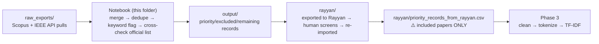

# MuTech Phase 1-2 — Collection & PRISMA Screening

**Systematic Literature Review on Intelligent Music Processing (MIR)**

Pulls candidate papers from Scopus and IEEE Xplore, merges and deduplicates them,
flags priority/exclude candidates by keyword, cross-checks against the team's curated
official-papers list, and produces the corpus that goes to [Rayyan](https://rayyan.ai)
for human PRISMA screening. The Rayyan-screened, included-only export is what
[Phase 3](../phase3) consumes.

## Where this sits in the pipeline

## Folder contents

| Folder | What's in it |
| --- | --- |
| `raw_exports/` | Everything the notebook reads as a starting input: the filtered Scopus export, the IEEE export, and the team's curated `CITE4D_Official_Papers.csv` reference list. (The unfiltered `Scopus_Raw.csv` and `MuTech_Master.csv` pulls were removed — nothing reads them; only the filtered exports feed the pipeline.) |
| `output/` | Everything the notebook writes: merged/deduplicated records, keyword-flagged priority/excluded/remaining sets, official-list cross-check matches, and the keyword/trend/co-authorship figures from the SNA section below. |
| `rayyan/` | The external Rayyan screening round-trip — `articles.csv`/`rayyan_articles.csv` (exported for screening) and `priority_records_from_rayyan.csv` (re-imported after human screening; this is the file Phase 3 actually runs on). None of these three are produced by the notebook itself. |

## `MuTech_Phase1_2_Collection_Screening.ipynb`

Two stages, kept in one notebook:
1. **Dataset consolidation** — pull/load raw exports, merge Scopus + IEEE into a common
   schema, dedupe by DOI and normalized title, flag records as priority/excluded/remaining
   by keyword match, and cross-check against the official curated list.
2. **Synthesis & SNA visualization** — keyword co-occurrence network, community detection,
   publication trend, and co-authorship plots on the 1,728 priority records (the
   pre-screening pool, before Rayyan). This is exploratory and predates Phase 3/4; the
   published dashboard at [`docs/index.html`](../docs/index.html) is now generated by
   [Phase 5](../phase5) from the final 365-paper included corpus instead.

All paths in the notebook are relative to this folder (`./raw_exports/...`,
`./output/...`) — run it from here, or open it in Colab and adjust the working directory
first.
