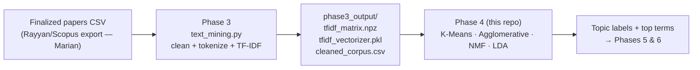

# MuTech Phase 4 — ML Topic Clustering

**Systematic Literature Review on Intelligent Music Processing (MIR)**

Groups the SLR papers into topics using all four models from the masterfile:
**K-Means, Agglomerative, NMF, and LDA**. Takes the TF-IDF output of
[Phase 3](https://github.com/UnityGrave/mutech-phase3-textmining) as input.

## 🚀 New here? Start with this

**No local setup needed.** Open
[`MuTech_Phase4_All_Models.ipynb`](MuTech_Phase4_All_Models.ipynb) in
[Google Colab](https://colab.research.google.com) (File ▸ Open notebook ▸ GitHub ▸
paste this repo's URL), then run every cell top to bottom. That's it — it clones
this repo, generates test data, runs all four models, and shows the results.

Running locally instead:

```bash
git clone https://github.com/UnityGrave/mutech-phase4-clustering.git
cd mutech-phase4-clustering
pip install -r requirements.txt
python topic_models.py --mock        # works today, no real data needed
```

## Where this sits in the pipeline



## 📌 Status (last updated July 8, 2026)

| Item | Status |
| --- | --- |
| Phase 4 code (all four models) | ✅ Done, tested end-to-end on mock data |
| Waiting on | ⏳ Finalized dataset → Phase 3 run on it |
| Then someone runs | `python topic_models.py --indir path/to/phase3_output` |
| Deadline | Phases 4 & 5 due **July 10** |

The **mock mode** exists so Phase 4 didn't have to wait for the dataset: it
fabricates ~100 synthetic papers in *exact* Phase 3 output format (same
filenames, schema, and TF-IDF settings). Swapping mock → real is only a path
change. **Nobody needs to edit code to finish this phase.**

Per the masterfile, each model has an owner: **K-Means — Kean · NMF — Marian ·
Agglomerative — Yesha · LDA — Dana**. This repo gives every owner a working
baseline for their model; still open per the masterfile: RandomizedSearchCV
tuning and a Topic Coherence score for LDA (the masterfile notes silhouette
isn't the right metric for LDA).

## The two scripts

| Script | What it does | When to use it |
| --- | --- | --- |
| `topic_models.py` | Runs **all four models** with a shared k and compares them (silhouette + ARI). | The main Phase 4 deliverable. |
| `kmeans_clustering.py` | K-Means only, in more depth: k-selection curves, distance-to-centroid per paper, saved model. | Digging into the primary model; also holds the shared loader + mock generator that `topic_models.py` imports. |

Common flags for both: `--mock` (synthetic data), `--indir DIR` (real Phase 3
output), `--outdir DIR`, `--k N` (force the number of topics).

## How to read the outputs

### 1. Choosing k (how many topics)

We try k = 2…12 and score each. **Left:** inertia ("elbow") — how tight the
clusters are; look for the bend. **Right:** silhouette — how well-separated
they are; higher is better, dashed line = the automatic pick. On the mock
corpus with 5 planted topics it correctly picks **k = 5**:


> ⚠️ On the real corpus the silhouette curve will likely be flatter and the
> score lower — that's normal for messy real text. The script warns you when
> this happens. Don't trust the automatic pick blindly: try a few k values
> with `--k` and keep the one whose top terms read like coherent SLR themes.

### 2. Seeing the clusters

TF-IDF space has ~2,000 dimensions, so we flatten it to 2D (TruncatedSVD)
purely for visualization. One dot = one paper, color = its cluster. Distinct
islands mean the clustering found real structure:


### 3. Comparing the four models

Same corpus, same k, four algorithms side by side:


And numerically (`model_comparison.csv`). **ARI** = Adjusted Rand Index between
two groupings: 1.0 = identical, ~0 = unrelated. Mock-run results:

| model | silhouette | ARI vs planted topics |
| --- | --- | --- |
| K-Means | 0.36 | **1.00** |
| Agglomerative | 0.36 | **1.00** |
| NMF | 0.36 | **1.00** |
| LDA | 0.29 | 0.78 |

Three of the four recover the planted topics perfectly. LDA merges two related
topics — expected on a small corpus: LDA is probabilistic, works on raw term
counts (rebuilt internally with `CountVectorizer`, because TF-IDF weights are
not valid LDA input), and typically wants more documents.

### 4. The deliverable files

`topic_models.py` → `phase4_output/models/`:

| File | What it is |
| --- | --- |
| `<model>_assignments.csv` | Paper → topic label, one file per model. **This is what Phases 5/6 consume.** |
| `<model>_top_terms.csv` | Top 15 terms per topic — use these to *name* the themes in the SLR. |
| `model_comparison.csv` | Silhouette + pairwise ARI. |
| `models_2d.png`, `models_summary.txt` | The comparison figure + a plain-text run recap. |

`kmeans_clustering.py` → `phase4_output/`: `cluster_assignments.csv`,
`cluster_top_terms.csv`, `k_selection.csv/.png`, `clusters_2d.png`,
`kmeans_model.pkl` (reload it later to label newly added papers), `run_summary.txt`.

## 🔧 Troubleshooting

| Symptom | Cause / fix |
| --- | --- |
| `Missing Phase 3 output file(s)` | You pointed `--indir` at the wrong folder, or Phase 3 hasn't been run yet. Use `--mock` to test without real data. |
| `Matrix rows != corpus rows` | The `.npz` and the `.csv` are from *different* Phase 3 runs. Re-run Phase 3 once and use all three files from the same run. |
| Silhouette warning / weird automatic k | Normal on real data — force k manually: `--k 5`, `--k 6`, … and compare top terms. |
| Empty/tiny vocabulary on a small test CSV | Phase 3's `min_df=2` drops terms that appear in <2 papers. Fine on the real ~100-paper corpus; on toy CSVs use mock mode instead. |
| LDA topics look merged/vague | Known small-corpus behavior (see comparison above). Report it; don't fight it. |
| Results differ between runs | They shouldn't — everything is seeded (`RANDOM_STATE = 42`). If they do, check you're on the same scikit-learn version (`pip install -r requirements.txt`). |

## Handing off to Phases 5/6

Everything downstream needs is in `phase4_output/models/`:
per-paper topic labels (`*_assignments.csv`) and human-readable topic
descriptions (`*_top_terms.csv`). The 2D figures and comparison table drop
straight into the SLR's methodology/results sections and the demo for Dr. Raffy.
