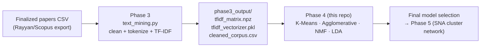

# MuTech Phase 4 — ML Topic Clustering

**Systematic Literature Review on Intelligent Music Processing (MIR)**

Groups the SLR papers into topics using all four models from the masterfile:
**K-Means, Agglomerative, NMF, and LDA**. Takes the TF-IDF output of
[Phase 3](../phase3) as input.

## 🚀 New here? Start with this

**Open [`MuTech_Phase4_Detailed_Analysis.ipynb`](MuTech_Phase4_Detailed_Analysis.ipynb).**
It's the canonical Phase 4 artifact: EDA, a leakage-safe 80/20 train/test split, all four
models each with baseline fit, held-out generalization check, `RandomizedSearchCV`
tuning, error analysis, and a final refit on the full 365-paper corpus — ending in an
explicit **final model selection** (K-Means; see `phase4_output_detailed/comparison/
FINAL_MODEL_SELECTION.txt` for the full rationale against the other three).

For a fast, untuned run (e.g. testing a change without the full validation pass), use the
scripts directly from the command line:

```bash
pip install -r requirements.txt
python topic_models.py --mock        # synthetic data, no real corpus needed
python kmeans_clustering.py --mock   # K-Means only, deeper k-selection diagnostics
```

There used to be two thin Colab-wrapper notebooks around these scripts
(`MuTech_Phase4_All_Models.ipynb`, `MuTech_Phase4_KMeans_Clustering.ipynb`); they were
removed because `MuTech_Phase4_Detailed_Analysis.ipynb` now runs every model they ran
with strictly more rigor (tuning, held-out validation, error analysis) — keeping them
around just meant three notebooks to maintain for the same four models. The scripts
themselves are untouched and still fully usable from the command line, including their
`--mock` synthetic-data mode.

## Where this sits in the pipeline



## 📌 Status

| Item | Status |
| --- | --- |
| All four models, quick pipeline (`topic_models.py`, `kmeans_clustering.py`) | ✅ Done — real run in `phase4_output_real/` |
| All four models, rigorous validation (`MuTech_Phase4_Detailed_Analysis.ipynb`) | ✅ Done — leakage-safe, tuned, validated, real run in `phase4_output_detailed/` |
| Final model selection | ✅ **K-Means** — see `phase4_output_detailed/comparison/FINAL_MODEL_SELECTION.txt` |

Per the masterfile, each model has an owner: **K-Means — Kean · NMF — Marian ·
Agglomerative — Yesha · LDA — Dana**.

## Two output directories — what's the difference

| Directory | Produced by | What it represents |
| --- | --- | --- |
| `phase4_output_real/` | `topic_models.py` / `kmeans_clustering.py` | Quick, untuned baseline — one shared k across all four models, no held-out validation. Useful as a fast sanity check. |
| `phase4_output_detailed/` | `MuTech_Phase4_Detailed_Analysis.ipynb` | The validated, leakage-safe result — each model independently tuned and held-out-tested before being refit on the full corpus. **This is the source of truth**; `comparison/FINAL_SELECTED_assignments.csv` is what Phase 5 and the manuscript should use. |

## The two scripts

| Script | What it does | When to use it |
| --- | --- | --- |
| `topic_models.py` | Runs all four models with a shared k and compares them (silhouette + ARI). | Fast iteration / sanity-checking a Phase 3 change, via `--mock` or `--indir`. |
| `kmeans_clustering.py` | K-Means only, in more depth: k-selection curves, distance-to-centroid per paper, saved model. Also holds the shared loader + mock generator that `topic_models.py` imports. | Digging into K-Means specifically without the full notebook. |

Common flags for both: `--mock` (synthetic data), `--indir DIR` (real Phase 3 output),
`--outdir DIR`, `--k N` (force the number of topics).

## 🔧 Troubleshooting

| Symptom | Cause / fix |
| --- | --- |
| `Missing Phase 3 output file(s)` | You pointed `--indir` at the wrong folder, or Phase 3 hasn't been run yet. Use `--mock` to test without real data. |
| `Matrix rows != corpus rows` | The `.npz` and the `.csv` are from *different* Phase 3 runs. Re-run Phase 3 once and use all three files from the same run. |
| Silhouette warning / weird automatic k | Normal on real data. The detailed notebook already searches k via `RandomizedSearchCV`; for the quick scripts, force k manually with `--k`. |

## Handing off to Phase 5

Phase 5 (`../phase5`) consumes `phase4_output_detailed/comparison/FINAL_SELECTED_assignments.csv`
and `FINAL_SELECTED_top_terms.csv` — the validated K-Means labels, not the quick-pipeline
output.
