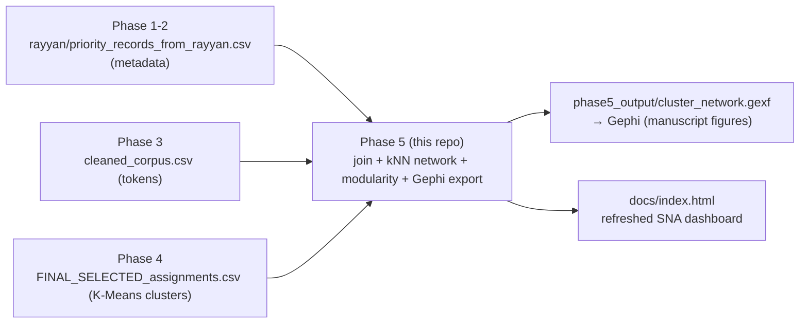

# MuTech Phase 5 — SNA Synthesis & Visualization

**Systematic Literature Review on Intelligent Music Processing (MIR)**

Analyzes how [Phase 4](../phase4)'s selected K-Means topic clusters relate to each other
as a network, exports that network to Gephi, and refreshes the SNA dashboard so it
reflects the final 365-paper PRISMA-included corpus end-to-end (the dashboard previously
ran on the 1,728-paper pre-screening pool, built before Phase 3/4 existed).

## Where this sits in the pipeline



## What the script does

1. **Joins** the three upstream artifacts on normalized title: Phase 1-2's Rayyan-screened
   metadata (authors, keywords, year), Phase 3's cleaned tokens, and Phase 4's final
   K-Means cluster assignments. Hard-fails if the join doesn't land on exactly 365 fully
   populated rows.
2. **Builds the cluster-relationship network**: nodes = all 365 papers, edges = top-8
   nearest neighbors by TF-IDF cosine similarity (same TF-IDF settings as Phase 3/4,
   refit deterministically — no pickled vectorizer is loaded).
3. **Analyzes cluster relationships**: modularity of the K-Means partition on that network,
   an independent Louvain community-detection cross-check (own modularity + Adjusted Rand
   Index against K-Means), and a 7×7 inter-cluster edge-count matrix.
4. **Exports to Gephi** (`cluster_network.gexf`) — every node carries title/year/cluster/
   cluster-label attributes, every edge carries its cosine-similarity weight.
5. **Rebuilds the SNA dashboard** (`../docs/index.html`): all four original tabs (keyword
   co-occurrence network, publication trend, co-authorship, top keywords) recomputed on
   the final 365-paper corpus instead of the stale 1,728-paper pool, plus a new **Topic
   Clusters** tab for the network from steps 2–4.

## Real result from the current run

Modularity of the Phase 4 K-Means partition on the paper-similarity network is
**0.5337** — well above the ~0.3 threshold generally considered evidence of real community
structure. An independent Louvain community detection on the same network (not told about
the K-Means labels at all) found 10 communities with modularity 0.6058, and agrees with
K-Means at an Adjusted Rand Index of 0.5250. Read together: the network structure
independently corroborates that the K-Means clusters are real topical groupings, not an
artifact of the clustering algorithm — a second line of evidence on top of Phase 4's own
silhouette/interpretability case for picking K-Means.

## Known data limitations

- `Publication Venue` is empty for all 365 papers in the source export, so the dashboard
  doesn't attempt a venue breakdown. Traced this to its actual root cause during a later
  Phase 4 EDA review, not left as a guess: about 90% of records are Scopus-sourced, and the
  Phase 1-2 notebook's Scopus extraction cell sets `df_scopus['Source'] = 'Scopus'` as a
  which-database flag, which a later harmonization step mistakenly copied into
  `Publication Venue` as if it were the real journal name (fixed for future runs, but the
  real Scopus venue field was never pulled from the API to begin with, so this can't be
  backfilled without re-pulling). The IEEE records did have a real venue, but it didn't
  survive the Rayyan export/re-import round trip. Both bugs are documented at the point
  they happen in `phase1_2/MuTech_Phase1_2_Collection_Screening.ipynb`.
- Most records in the final corpus's `Authors` field carry only one name, so the
  co-authorship tab is genuinely sparser than a typical bibliometric map. That's a property
  of the upstream export, not something this script introduced (the same pattern exists in
  the larger 1,728-paper pre-screening pool).

## Outputs (in `phase5_output/`)

| File | What it is |
| --- | --- |
| `cluster_network.gexf` | The full paper-similarity network, Gephi-ready. |
| `cluster_relationship_matrix.csv` | Inter-cluster edge-count matrix. |
| `network_summary.txt` | Modularity, Louvain comparison, network sizes — counts for manuscript reporting. |

## How to run

```bash
pip install -r requirements.txt
python sna_synthesis.py
```

Requires Phase 1-2's Rayyan export, Phase 3's `cleaned_corpus.csv`, and Phase 4's
`FINAL_SELECTED_assignments.csv` to already exist (all three are checked in).
