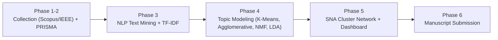

# Systematic Literature Review (SLR) Research Pipeline
## Intelligent Music Processing for Singing, Ensembles, and Instrumental Performance

This directory contains the complete academic research pipeline analyzing **365 peer-reviewed studies** collected from Scopus and IEEE Xplore, synthesized following the **PRISMA 2020** methodology.

---

## Pipeline Overview

---

## Directory Structure

| Folder | Phase & Focus | Status | Deliverables |
|---|---|:---:|---|
| [`phase1_2/`](phase1_2) | **Study Collection & Screening** | ✅ Done | Scopus & IEEE search exports, Rayyan inclusion logs (365 studies included) |
| [`phase3/`](phase3) | **NLP Text Mining & Vectorization** | ✅ Done | Cleaning, lemmatization, tokenization, and TF-IDF matrix generation |
| [`phase4/`](phase4) | **Unsupervised Machine Learning Topic Models** | ✅ Done | Comparison of K-Means, Agglomerative, NMF, and LDA. **K-Means selected as optimal** |
| [`phase5/`](phase5) | **Social Network Analysis (SNA)** | ✅ Done | Co-occurrence network (NetworkX + Gephi), modularity 0.53 |
| [`phase6_manuscript/`](phase6_manuscript) | **Academic Manuscript & Publication Figures** | ⏳ In Progress | Manuscript draft, high-res PRISMA flowcharts, and LaTeX tables |
| [`guides/`](guides) | **Research Audit Logs & Guides** | ✅ Done | Root-cause audit history (`ROOT_CAUSE_AUDIT.md`) and paper update guide (`SLR_PAPER_UPDATE_GUIDE.md`) |

---

## Published Interactive SNA Dashboard

The interactive topic co-occurrence network generated in Phase 5 is published via GitHub Pages:
- Live Dashboard: [https://dalouuu.github.io/MuTech/](https://dalouuu.github.io/MuTech/)
- Source file: [`docs/index.html`](../docs/index.html)
