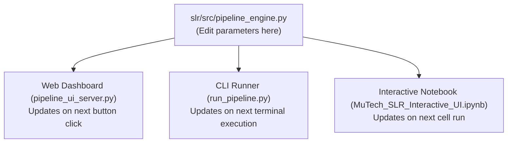

# MuTech SLR Pipeline: Configuration & Code Customization Guide
## Where to Edit Parameters, Thresholds, and Algorithms Across Phases 1 to 5

This guide provides a comprehensive roadmap for the research team on where and how to modify the pipeline. All shared logic is centralized in a single file to maintain consistency across the **Web UI**, the **CLI runner**, and the **Jupyter Notebooks**.

---

### The Single Source of Truth: `slr/src/pipeline_engine.py`

Whenever you need to adjust domain rules, keywords, model hyperparameters, or network thresholds, edit [`slr/src/pipeline_engine.py`](../src/pipeline_engine.py). Any change saved to this file takes effect immediately across all interfaces.



---

### Phase-by-Phase Customization Reference

#### Phase 1: Database Ingestion & Deduplication
* **File Location:** [`slr/src/pipeline_engine.py`](../src/pipeline_engine.py), function `run_phase1(raw_dir, out_dir)`
* **What you can customize:**
  1. **Source Export Filenames (Lines ~90–95):**
     * Currently looks for `Scopus_Filtered.csv` and any file matching `IEEE_export*.csv` in `slr/data/01_raw/`.
     * To change input filenames or add Web of Science / PubMed exports, modify the file resolution block.
  2. **Column Harmonization (Lines ~100–125):**
     * Maps database-specific headers (`Document Title`, `Publication Year`, `Mesh_Terms`) to our canonical schema: `Title`, `Abstract`, `Authors`, `Year`, `DOI`, `Keywords`, `Publication Venue`, `Source Database`.
  3. **Title Normalization Regex (Line ~135):**
     ```python
     merged["Title_norm"] = merged["Title"].str.lower().str.strip().str.replace(r"[^\w\s]", "", regex=True)
     ```
     * Controls how titles are sanitized before deduplication.

---

#### Phase 2: PRISMA Screening & Rayyan Handshake
* **File Location:** [`slr/src/pipeline_engine.py`](../src/pipeline_engine.py), arrays `EXCLUDE_TERMS` and `PRIORITY_TERMS` (Lines ~50–85) & function `run_phase2()`
* **What you can customize:**
  1. **Exclusion Vocabulary (`EXCLUDE_TERMS`):**
     * Add off-topic keywords to automatically flag biomedical studies, speech recognition, music recommendation, or clinical trials:
     ```python
     EXCLUDE_TERMS = [
         "speech recognition", "speaker recognition", "speech synthesis",
         "parkinson", "alzheimer", "pathology", "clinical", "medical", ...
     ]
     ```
  2. **Priority Target Vocabulary (`PRIORITY_TERMS`):**
     * Add target MIR terms that qualify a paper as high-priority:
     ```python
     PRIORITY_TERMS = [
         "music information retrieval", "mir", "music transcription",
         "source separation", "singing voice", "multi pitch estimation", ...
     ]
     ```
  3. **Screening Mode Toggle:**
     * Set `use_rayyan=True` to use the human-screened PRISMA included corpus (`priority_records_from_rayyan.csv`, N=365).
     * Set `use_rayyan=False` to operate on automated rule-based priority candidates.

---

#### Phase 3: NLP Text Mining, Preprocessing & Vectorization
* **File Location:** [`slr/src/pipeline_engine.py`](../src/pipeline_engine.py), arrays `PHRASE_COLLOCATIONS` and `EXTRA_STOPWORDS` (Lines ~25–50) & function `run_phase3()`
* **What you can customize:**
  1. **Multi-Word Phrase Collocations (`PHRASE_COLLOCATIONS`):**
     * Preserves compound technical terms as single tokens so spaCy does not fragment them:
     ```python
     PHRASE_COLLOCATIONS = [
         ("music information retrieval", "music_information_retrieval"),
         ("automatic music transcription", "automatic_music_transcription"),
         ("source separation", "source_separation"),
         ("multi pitch estimation", "multi_pitch_estimation"),
         ("optical music recognition", "optical_music_recognition"),
     ]
     ```
  2. **Domain-Specific Stopwords (`EXTRA_STOPWORDS`):**
     * Prunes high-frequency, non-discriminative academic and MIR jargon (Sarica & Luo, 2021):
     ```python
     EXTRA_STOPWORDS = {
         "study", "paper", "result", "method", "approach", "proposed",
         "music", "musical", "audio", "sound", "performance", "task",
         "algorithm", "system", "evaluation", "dataset", ...
     }
     ```
  3. **TF-IDF Vectorizer Hyperparameters (Line ~255):**
     ```python
     TFIDF_PARAMS = dict(
         max_features=2000,    # Max vocabulary size
         min_df=2,             # Ignore terms appearing in < 2 documents
         max_df=0.85,          # Ignore terms appearing in > 85% of documents
         ngram_range=(1, 2),   # Unigrams + bigrams
         sublinear_tf=True     # Sublinear TF scaling: 1 + log(tf)
     )
     ```
  4. **LSA Latent Dimensions (Line ~260):**
     ```python
     svd = TruncatedSVD(n_components=35, random_state=RANDOM_STATE)
     ```
     * Adjust `n_components` (recommended range: 25 to 50) to tune the dense latent representation for K-Means.

  5. **Automated PMI Collocation Mining (Lines ~45–80):**
     ```python
     def mine_pmi_collocations(texts, min_count=3, min_npmi=0.50, max_collocations=30):
     ```
     * `min_count`: Minimum corpus occurrences for a candidate bigram (default: 3).
     * `min_npmi`: Normalized Pointwise Mutual Information threshold between $[-1, 1]$ (default: $0.50$). Higher values extract tighter, more technical phrase bindings.
     * `max_collocations`: Maximum automatically discovered phrases to bind into tokens.

  6. **Dense Embeddings & SciBERT Toggle (Lines ~85–115):**
     ```python
     def extract_dense_embeddings(corpus_texts, X_tfidf, method="lsa", n_components=35):
     ```
     * `method="lsa"`: Uses fast TruncatedSVD dimensionality reduction with L2 normalization (standard, fast, CPU-friendly).
     * `method="scibert"`: Uses `allenai/scibert_scivocab_uncased` contextual transformer embeddings if `transformers` and `torch` are installed.

---

#### Phase 4: 4-Model Suite Benchmarking, Soft Topics & Stability
* **File Location:** [`slr/src/pipeline_engine.py`](../src/pipeline_engine.py), functions `run_phase4()` and `compute_topic_stability()`
* **What you can customize:**
  1. **Number of Topics ($k$):**
     * Default parameter `target_k=7`. Can be overridden via CLI (`--k 8`), Web UI slider, or by changing the default argument in `run_phase4`.
  2. **Algorithm Hyperparameters:**
     * **K-Means:** `n_init=25` (number of restarts), `random_state=42`.
     * **Agglomerative:** `metric="cosine"`, `linkage="average"` (fitted on dense 35-D LSA space).
     * **NMF:** `init="nndsvda"`, `max_iter=500`.
     * **LDA:** `max_iter=50`, `learning_method="batch"`.
  3. **Topic Stability Bootstrapping (`compute_topic_stability`):**
     ```python
     compute_topic_stability(X_dense, target_k=7, n_bootstraps=10)
     ```
     * Adjust `n_bootstraps` (default: 10) to increase statistical power of consensus stability testing across randomized restarts.
  4. **Soft Multi-Topic Membership & Interdisciplinarity Thresholds:**
     * Evaluates continuous Dirichlet posterior topic distributions ($\theta_d$) from LDA.
     * `is_interdisc = bool(top2_p >= 0.20 or entropy > 1.8)`:
       * Adjust `top2_p` (default: 0.20) to define when a secondary topic has significant presence in a paper.
       * Adjust `entropy` threshold (default: 1.8 bits) to identify boundary-spanning papers across subfields.
  5. **c-TF-IDF Keyword Extraction Count (`compute_c_tfidf`):**
     * Change `top_n=10` or `12` to extract more or fewer distinctive keywords per topic.

---

#### Phase 5: Social Network Analysis & Longitudinal Evolution
* **File Location:** [`slr/src/pipeline_engine.py`](../src/pipeline_engine.py), functions `run_phase5()` and `compute_temporal_topic_evolution()`
* **What you can customize:**
  1. **k-Nearest Neighbors Degree (`k_neighbors`):**
     * Default `k_neighbors=8`. Controls how many edges each paper establishes in the similarity graph.
  2. **Cosine Similarity Threshold (Line ~375):**
     ```python
     sim = float(1.0 - distances[i, j_idx])
     if sim > 0.05:  # Minimum edge weight threshold
         G.add_edge(i, neighbor, weight=sim)
     ```
  3. **Longitudinal Epoch Time-Bins (`compute_temporal_topic_evolution`):**
     ```python
     time_bins = [
         ("Foundational (2020-2021)", 2020, 2021),
         ("Consolidation (2022-2023)", 2022, 2023),
         ("Modern/Expansion (2024-2026)", 2024, 2026)
     ]
     ```
     * Modify year intervals to alter how papers are grouped into historical and modern research epochs for alluvial/Sankey flow tracking.
  4. **Live Dashboard Output Path:**
     * Exports Gephi `.gexf` file to `slr/outputs/network/phase5_cluster_network.gexf`.
     * Exports temporal trajectory flow links to `slr/outputs/network/phase5_temporal_topic_evolution.csv`.
     * Synchronizes the interactive dashboard at `docs/index.html`.

---

### Summary Checklist for Making Updates

| What you want to do | File to edit | Variable or Function to change |
|---|---|---|
| Add an off-topic keyword to exclude | `slr/src/pipeline_engine.py` | `EXCLUDE_TERMS` list |
| Add a priority MIR concept | `slr/src/pipeline_engine.py` | `PRIORITY_TERMS` list |
| Bind a new 2-word technical phrase | `slr/src/pipeline_engine.py` | `PHRASE_COLLOCATIONS` list |
| Adjust automated PMI sensitivity | `slr/src/pipeline_engine.py` | `mine_pmi_collocations(min_npmi=...)` |
| Filter out an over-represented word | `slr/src/pipeline_engine.py` | `EXTRA_STOPWORDS` set |
| Change the number of topics | `slr/src/pipeline_engine.py` (or CLI / UI) | `target_k` parameter |
| Change the LSA dimension count | `slr/src/pipeline_engine.py` | `TruncatedSVD(n_components=...)` |
| Adjust soft topic crossover cutoff | `slr/src/pipeline_engine.py` | `top2_p >= 0.20 or entropy > 1.8` |
| Adjust stability bootstrap iterations | `slr/src/pipeline_engine.py` | `compute_topic_stability(n_bootstraps=...)` |
| Adjust network edge density | `slr/src/pipeline_engine.py` | `k_neighbors` parameter |
| Redefine temporal historical epochs | `slr/src/pipeline_engine.py` | `time_bins` in `compute_temporal_topic_evolution` |

